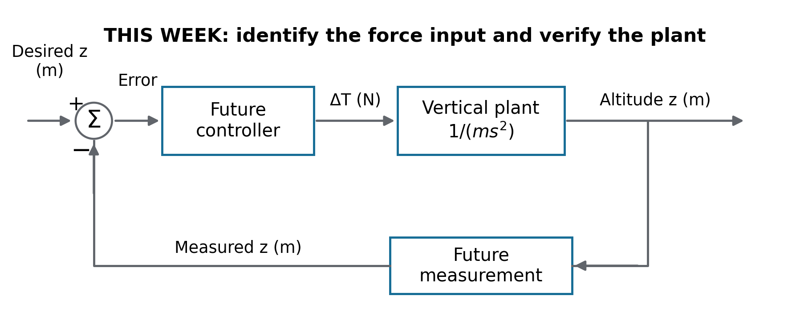
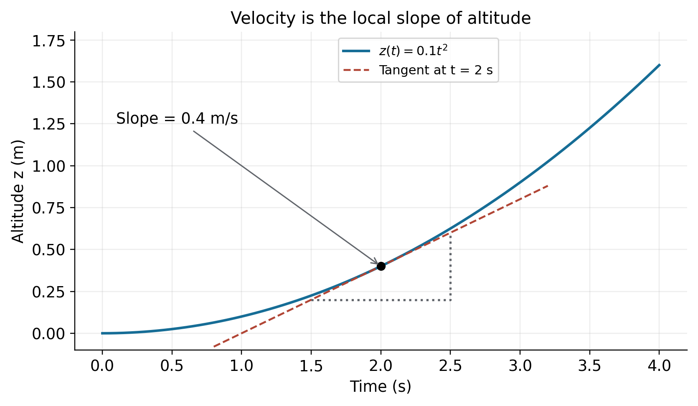
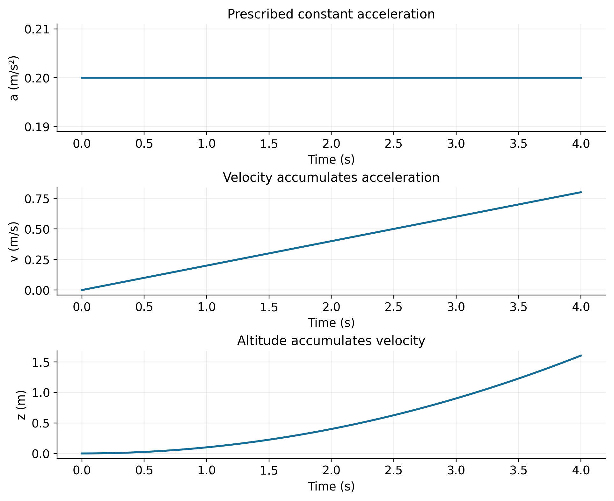
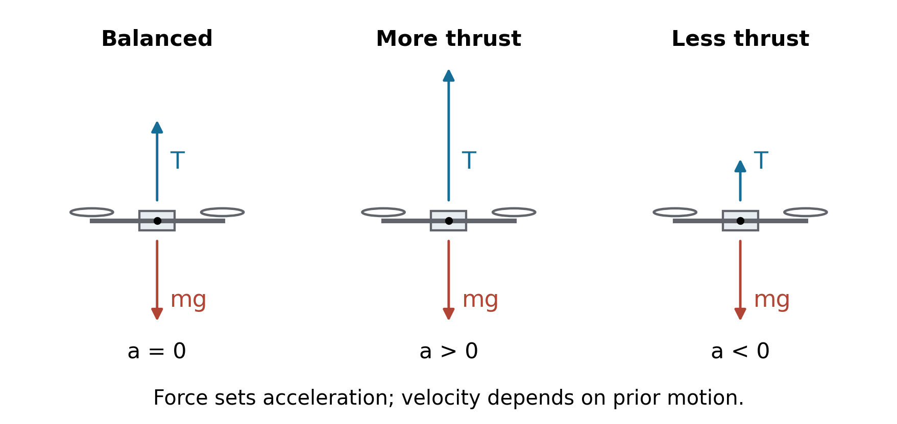
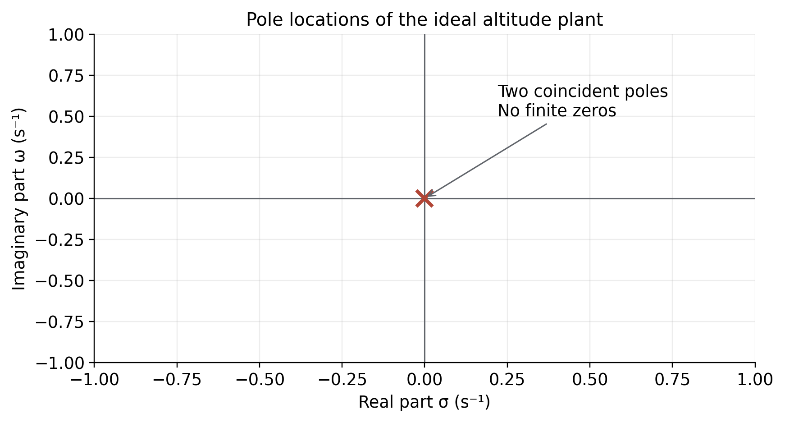
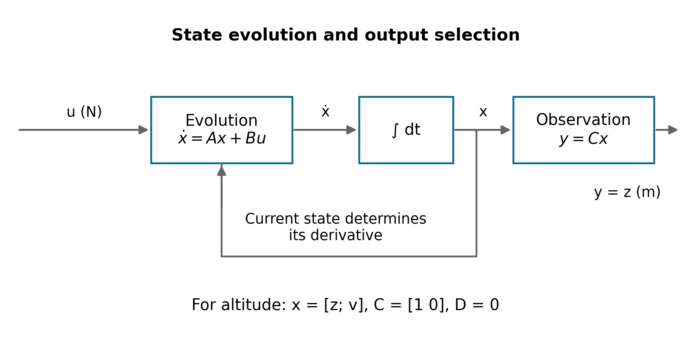
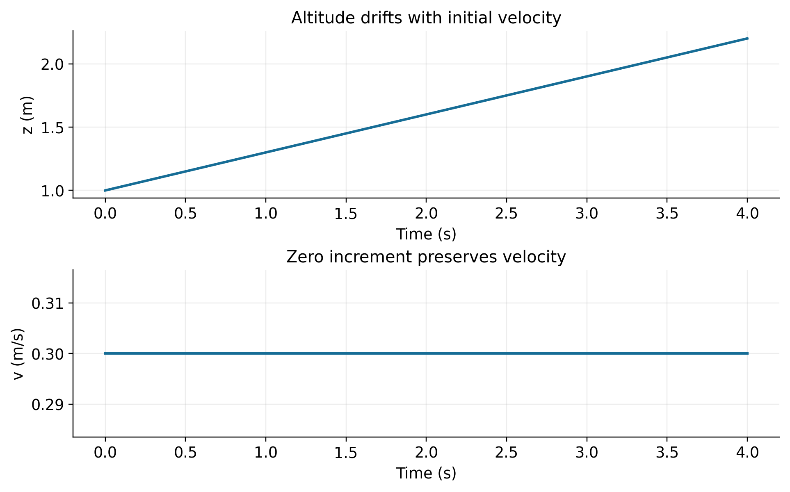
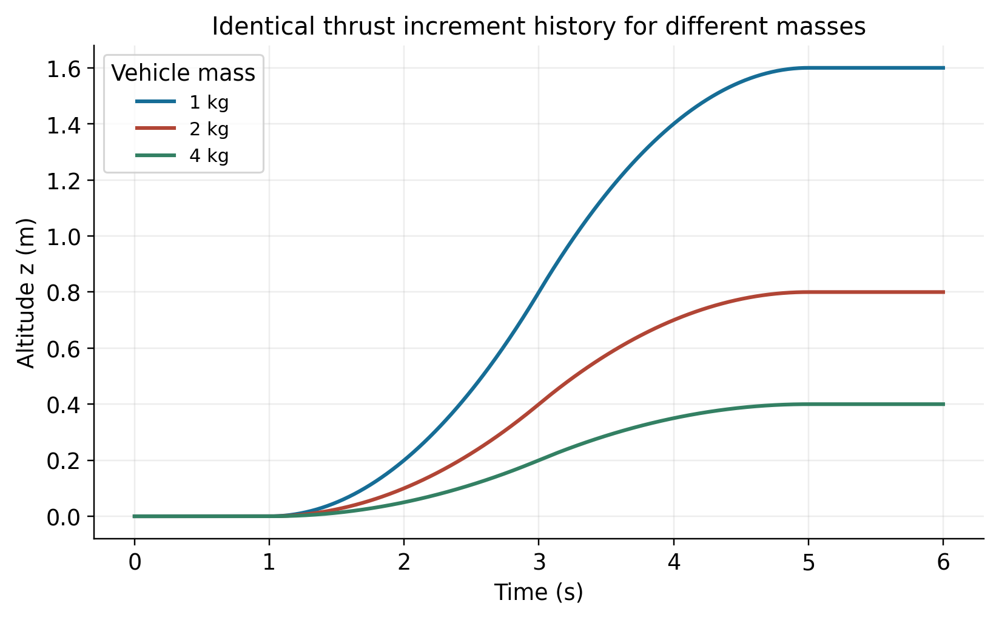
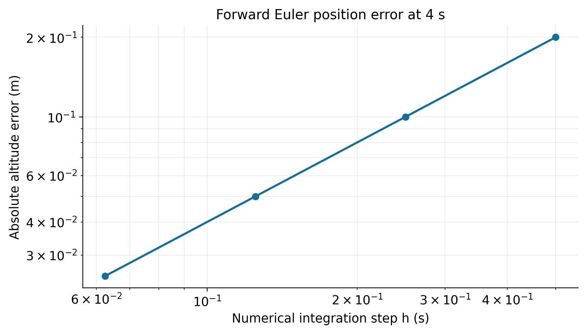

# How to use this volume

The purpose of this book is to help you derive, implement, and verify the simplest useful altitude model of a multirotor. By the end of Day 7, you should be able to explain every force, equation, state, signal, and block in that model without relying on a saved script. A simulation that runs is only an intermediate result. The real deliverable is a defensible explanation of why it runs that way.

The complete project is **UAV Control Engineering — From First-Principles Modeling to MATLAB, Simulink, ROS 2, SITL, LQR and MPC**. This volume covers Days 1–7 of the proposed 40-day sequence. It establishes mathematical prerequisites, vertical physics, MATLAB analysis, and Simulink plant construction. Controller design begins in Volume 2. A successful week here does not constitute a flight controller or validation of an actual aircraft.

Work with a notebook, MATLAB, and Simulink open together. First sketch the expected result. Next derive a numerical checkpoint by hand. Then implement the model, run it, and compare. Finally explain discrepancies in words. Keep your first wrong prediction; correcting it is useful evidence of learning. The solutions are collected after all seven days and the assessment so you can attempt the questions without immediately seeing their answers.

## The daily working rhythm

Each day has exactly the same fourteen parts, A through N. The timing table gives a realistic four-hour core session, including short breaks. Optional extensions are for a fifth hour. If a completion gate fails, repeat that lesson before progressing; the calendar is a planning aid, not evidence of competence. Do the short daily reading inside the theory allocation. The end-of-volume assessment fits inside Day 7's five-hour option or can replace that day's optional extensions.

| Session activity | Minutes | What you actually do |
|:--|--:|:--|
| Recall and prediction | 15 | Answer from memory and sketch expected signals |
| Theory and targeted reading | 50 | Read, annotate, and relate the explanation to the aircraft |
| Hand derivation and worked example | 35 | Derive with units before checking the example |
| MATLAB laboratory | 40 | Run small sections, inspect values, and label figures |
| Simulink laboratory | 45 | Build or modify blocks and verify intermediate signals |
| Exercises and debugging | 25 | Attempt the assigned problems without solutions |
| Notebook, Git, and completion gate | 15 | Record evidence and explain the model aloud |
| Breaks | 15 | Three short breaks |
| Total | 240 | Four hours; add at most 60 minutes for extensions or assessment |

This is a demanding first week. You do not have to read every optional explanation twice. However, do not skip the derivations, predictions, or checks in order to finish faster. Those are the parts that will make later PID and state-space work understandable.

## Software and companion files

Use a MATLAB installation with Simulink and Control System Toolbox. Base MATLAB handles arrays, plots, and `ode45`; Control System Toolbox supplies `tf`, `ss`, `pole`, `zero`, `step`, `impulse`, and `lsim`. Simulink supplies the block environment. No Aerospace Toolbox, ROS installation, autopilot, GPU, or physical UAV is needed this week. If a toolbox is unavailable, complete the hand derivations and base-MATLAB labs, and record the uncompleted software gate accurately.

Extract `UAV_Volume_1_Companion.zip`. In MATLAB, set Current Folder to the extracted `UAV_Volume_1_Companion` folder and run `startup_volume1`. Run a daily script only after making its prediction. The scripts produce your plots under `figures/student` and data under `results`. The `figures/reference` images are instructional reference figures, not your experimental evidence.

Official MathWorks documentation was checked on 5 October 2026. The linked pages may track a newer release than yours. Use the Help button in your installed block dialog when labels differ. Record `version('-release')` and `ver` in your notebook. The companion code is provided as reference source with mathematical checks. MATLAB and Simulink were not available in the authoring environment, so the `.m` files and optional model builder have not been executed in those products. The plotted numerical references were independently generated from the stated equations, and numerical cross-checks are documented in the companion validation record. Run the included acceptance checks on your installation before treating a model as verified.

The optional builder creates `v1_equivalent.slx` and `v1_weekly.slx` locally when run in MATLAB with Simulink. These are generated outputs, not pretested `.slx` files in the download. Build the Day 5 model manually once before inspecting the builder. It is a recovery and reproducibility aid, not a substitute for understanding the diagram.

## Conventions used throughout

| Symbol | Meaning | Unit or shape |
|:--|:--|:--|
| $t$ | Time | s |
| $m$ | Constant vehicle mass | kg |
| $g$ | Positive gravitational acceleration magnitude | m/s² |
| $z$ | Upward altitude relative to a fixed datum | m |
| $v=\dot z$ | Upward vertical velocity | m/s |
| $a=\ddot z$ | Upward vertical acceleration | m/s² |
| $T_i$ | Upward thrust magnitude of rotor $i$ when level | N |
| $T=\sum_i T_i$ | Total rotor thrust magnitude | N |
| $T_0=mg$ | Hover operating thrust | N |
| $u=\Delta T=T-T_0$ | Thrust increment about hover | N |
| $z_{\mathrm{eq}}$ | Selected constant equilibrium altitude | m |
| $x=[z\;v]^\mathsf T$ | Physical state vector | 2 by 1, mixed units |
| $y$ | Selected output, normally altitude | m |
| $s=\sigma+j\omega$ | Laplace variable | s⁻¹ |
| $G(s)$ | Zero-state map from thrust increment to altitude | m/N |

Boldface is not required to distinguish vectors: their dimensions and definitions do that work. The same letter $m$ appears as mass in formulas and as the unit metre in labels; context distinguishes them. MATLAB uses `p.m` or `m` for the numerical mass in kilograms. Uppercase `T` is thrust; time is always lowercase `t`. The imaginary unit $j$ in Laplace expressions is not a loop index.

We choose a local world frame with east, north, up axes and a body frame with forward, left, up axes. Both are right handed. At level attitude the body up axis is parallel to world up. We use these conventions for this book only. Later aerospace and autopilot materials may use north, east, down and forward, right, down. Translating between those conventions will be explicit; a sign change is never an unannounced correction.

Unless stated otherwise, choose the altitude datum at the nominal hover position. Then $z_{\mathrm{eq}}=0$ and $z$ is both a position relative to that datum and an altitude deviation. A negative $z$ means below that datum. The model has no ground contact, so it does not know when a simulated vehicle would hit the floor.

## The learning map

| Day | Main question | New evidence produced |
|--:|:--|:--|
| 1 | What do derivatives and integrators mean for altitude? | Kinematic plots and a two-integrator model |
| 2 | How do real vertical forces determine motion? | Free-body diagram and total-thrust model |
| 3 | Why introduce hover deviations? | Absolute/deviation agreement and ODE checks |
| 4 | Where does $1/(ms^2)$ come from? | Transform derivation and response interpretation |
| 5 | Why can three diagrams represent one plant? | Quantitative Simulink equivalence test |
| 6 | Why retain altitude and velocity as states? | Matrix derivation and initial-state experiment |
| 7 | Can you defend the model independently? | Cumulative experiment and engineering report |

## Reading as a targeted tool

Nise is the main reference for the language and mathematics of classical control. Use topic headings rather than guessed page numbers. Locate the sections on mathematical models, Laplace transforms, transfer functions, time response, state equations, and block-diagram reduction in your edition. The publisher's table of contents confirms this topic organization [R1]. Do not read the advanced design chapters simply because they appear nearby.

Beard and McLain is the UAV supplement. Its coordinate-frame and rigid-body modeling discussions help you connect a scalar altitude equation with aircraft mechanics. Much of the book concerns fixed-wing aircraft; fixed-wing lift and propulsion models should not be transplanted into a multirotor hover model. The authors' companion repository identifies the relevant topics and also distinguishes its evolving draft from the published text [R2]. Read for concepts this week, not to copy an aircraft simulation.

# Day 1 Mathematical language and the first moving model

## A Learning objectives

Explain a function, derivative, integral, and initial condition using a moving UAV. Distinguish position, velocity, and acceleration by their units. Create a MATLAB script with vectors and labelled plots. Build a simple Simulink model whose two integrators have a clear physical meaning. Identify what part of a future control system the plant represents.

## B Prerequisite recall

Before reading further, write answers to these questions. What does a speed of 2 m/s mean? If velocity increases from 0 to 1 m/s in two seconds, what is the average acceleration? Can an object have zero acceleration while moving? Why does knowing the current position alone fail to predict its future position? Keep your answers for comparison with the concept check.

## C Theory lesson

### A physical system and its mathematical description

A multirotor has motors that turn propellers, a rigid central structure, sensors, and computation. Rotors exchange momentum with air; forces then change the vehicle's motion. A controller will eventually compare measured motion with a desired motion and choose an input. For now we isolate the **plant**, the part of the physical process that maps an applied thrust increment to movement. Its input will have units of newtons. It is not yet a normalized throttle command, motor voltage, or rotor speed.



An input is a quantity supplied to the model; an output is a quantity we choose to observe. A state is information about the current condition needed to predict future evolution once the future input is known. Position is a sensible output. Position and velocity together will be the state. The controller in Figure 1 is only context; no gain is selected this week.

### Functions and derivatives describe motion

A variable is a quantity that can take different values. A function gives a rule relating quantities. Writing $z(t)$ says that altitude depends on time. For example, the function $z(t)=0.1t^2$ assigns 0.4 m at 2 s and 1.6 m at 4 s, when the coefficient is understood to carry units m/s². A formula without units can hide an error, so identify the coefficient's dimensions as well as its value.

Average vertical velocity over a time interval is displacement divided by elapsed time. Instantaneous velocity is the limit as that interval shrinks:

$$v(t)=\dot z(t)=\lim_{h\to0}\frac{z(t+h)-z(t)}{h}.$$

Here $h$ is a small time increment in seconds. A dot means a time derivative. Geometrically, velocity is the slope of the altitude curve. Positive slope means climbing; negative slope means descending. A horizontal altitude curve means zero vertical velocity at that instant.

Acceleration measures the rate of change of velocity:

$$a(t)=\dot v(t)=\ddot z(t).$$

Positive acceleration means the velocity is becoming more positive. If the UAV is descending, positive acceleration can slow the descent while the vehicle still moves downward. Force direction therefore determines acceleration direction, not necessarily velocity direction. This distinction will explain why thrust above weight can be used to stop a descent.



### Integrals reconstruct motion and retain history

If acceleration is known, integrate it to obtain the change in velocity. Then add the initial velocity. Integrating velocity similarly gives displacement, to which the initial position must be added:

$$v(t)=v_0+\int_0^t a(\tau)\,d\tau,\qquad z(t)=z_0+\int_0^t v(\tau)\,d\tau.$$

The dummy variable $\tau$ is another time variable measured in seconds. The symbols $z_0=z(0)$ and $v_0=v(0)$ are initial conditions. A signal of 0.2 m/s² held for four seconds adds 0.8 m/s of velocity. The area under the velocity curve is displacement. An integrator is a memory element: the present output contains accumulated past input.

For constant acceleration $a_0$, performing both integrals gives

$$v(t)=v_0+a_0t,\qquad z(t)=z_0+v_0t+\frac12a_0t^2.$$

Doubling $a_0$ doubles the acceleration-induced terms. Doubling time doubles the velocity increment but quadruples the acceleration-induced displacement. Those are different experiments. A linear system can have a curved output in time: linearity concerns the relationship between input signals and output signals, not whether a plotted trajectory is a straight line.

### Differential equations specify a rule of evolution

The equation $\dot z=v$ is a first-order differential equation because its highest derivative of $z$ is first order. The equation $\ddot z=a_0$ is second order in $z$. It needs two scalar initial conditions. Rewriting a second-order equation as two coupled first-order equations makes its memory explicit. A solver will carry both altitude and velocity through time.

A continuous-time model permits a state at every real time. A computer cannot store infinitely many values, so it approximates the trajectory at selected times. The model and the numerical procedure are different things. Changing the plotting interval does not automatically create a digital controller or change the physical equation.

### Vectors and matrices will organize related quantities

The vector $[z\;v]^\mathsf T$ is a two-entry column: altitude above velocity. The superscript $\mathsf T$ means transpose. Its entries have different units, which is permissible. It is not a vector of spatial directions; it is a list of state quantities. By contrast, the spatial position vector $[p_E\;p_N\;z]^\mathsf T$ has three entries all measured in metres.

A matrix is a rectangular array that can map one vector to another. Row-by-column multiplication will later encode $\dot z=v$ and $\dot v=u/m$. In MATLAB, `[1 2]` is a row and `[1;2]` is a column. Dimensions are as important as values: an incorrectly oriented vector may create an error or an unintended array. Day 6 will develop the full matrix calculation after you have seen the motion it represents.

**Reading with a purpose.** Spend ten minutes in Nise's introductory discussion of physical systems, inputs, outputs, and modeling [R1]. Find one mechanical example and identify its input and output. The purpose is to learn the vocabulary, not to import that example's equation into the UAV.

## D Hand derivation

Start with $a(t)=a_0$. Integrate from 0 to $t$ to obtain velocity, including $v_0$. Integrate again to obtain altitude, including $z_0$. Beside each term write units: $a_0t$ must be m/s, $v_0t$ and $a_0t^2/2$ must both be metres. Differentiate your final altitude expression twice to recover $a_0$. Substitute $t=0$ to recover both initial conditions. This is your first verification cycle.

## E Worked example

Take $z_0=0$ m, $v_0=0$ m/s, and $a_0=0.2$ m/s². At four seconds,

$$v(4)=0+0.2(4)=0.8\ \mathrm{m/s},\qquad z(4)=0+0+\frac12(0.2)(4^2)=1.6\ \mathrm m.$$

The velocity graph is a straight rising line and the altitude graph curves upward. The average velocity over this interval is 0.4 m/s, so average velocity times four seconds gives the same 1.6 m displacement. The number 0.2 is a prescribed acceleration today; Day 2 will derive acceleration from force.

## F MATLAB laboratory

Open a new script, save it as `matlab/day01_kinematics.m`, and write the code below in sections. A script runs commands in the workspace. The workspace holds named arrays until they are cleared or MATLAB closes. The Command Window is useful for individual checks; the Editor stores a repeatable procedure. Avoid naming your file `plot.m`, `sum.m`, or `tf.m`, because those names can hide MATLAB functions.

**Predict first.** Sketch all three signals. Write the expected values at 0, 2, and 4 seconds. Then run `startup_volume1`, inspect its printed environment information, and execute the daily script.

```matlab
% PREDICT: a is constant. What shapes will v(t) and z(t) have?
p = volume1_parameters();
t = (0:p.dt:4)';           % column of output times, seconds
a0 = 0.2;                 % prescribed acceleration, m/s^2
v = p.v0 + a0*t;
z = p.z0 + p.v0*t + 0.5*a0*t.^2;
a = a0*ones(size(t));
assert(abs(z(end)-1.6)<1e-12,'Check position formula.');
figure('Name','Day 1 kinematics');
subplot(3,1,1); plot(t,a,'LineWidth',1.5); grid on;
title('Prescribed constant acceleration');
xlabel('Time (s)'); ylabel('a (m/s^2)');
subplot(3,1,2); plot(t,v,'LineWidth',1.5); grid on;
title('Velocity accumulates acceleration');
xlabel('Time (s)'); ylabel('v (m/s)');
subplot(3,1,3); plot(t,z,'LineWidth',1.5); grid on;
title('Altitude accumulates velocity');
xlabel('Time (s)'); ylabel('z (m)');
print(gcf,fullfile(figure_dir,'day01_kinematics.png'),'-dpng','-r180');
save(fullfile(result_dir,'day01.mat'),'t','a','v','z','a0','p');
```

`volume1_parameters` returns a structure, a collection of named fields. `p.dt` accesses one field. The colon expression produces evenly spaced times; the apostrophe turns the resulting real row into a column. `t.^2` squares each element. By contrast, `t^2` requests a matrix power and is not appropriate for this column vector. `ones(size(t))` creates a constant signal with one value per time. A semicolon suppresses printing but does not change the calculation. A percent sign introduces a comment.

The `assert` statement checks a specific hand prediction. If you deliberately change acceleration or initial conditions, update that prediction too. Each `subplot` selects a panel. `plot` draws it; `xlabel`, `ylabel`, `title`, and `grid` make it interpretable. A legend is unnecessary for a panel with only one trace. `print` exports the current figure, and `save` stores numerical variables in a MAT-file. Inspect `size(t)`, `z(201)`, and `whos` in the Command Window. The 201st element corresponds to 2 s because indexing begins at one.



## G Simulink laboratory

Simulink evaluates connected mathematical blocks and integrates state derivatives over simulation time. Wires carry signals, not physical copper currents. A signal of value 0.2 could mean newtons or m/s²; you must label its meaning. The same block type can serve different physical roles depending on the surrounding equation.

1. Open Simulink from MATLAB, create a blank model, and save it as `simulink/day01_kinematics.slx`. Use the Library Browser search or canvas block search to find the exact block names below.
2. Add a **Constant** block with value `0.2`. Label its output `a_mps2`. This supplies $a(t)$; no force equation is represented yet.
3. Add two **Integrator** blocks in series. The first integrates acceleration to velocity and has initial condition `0`. Rename it `Velocity`. The second integrates velocity to altitude, also with initial condition `0`; rename it `Altitude` [M5].
4. Connect Constant to Velocity to Altitude. Branch the acceleration, velocity, and altitude signals to three separate **Scope** blocks. Separate axes preserve the different units. Name the scopes `Acceleration`, `Velocity`, and `Altitude`.
5. Set Start time to `0` and Stop time to `4`. In Model Settings, choose a variable-step solver and `ode45`, with maximum step size `0.01`. This is an integration setting, not a controller sampling period [M7].
6. Run, open the scopes, and use their autoscale control. Check the terminal velocity and altitude against your hand values. Change only the first integrator's initial condition to `0.3` and predict which curves change before rerunning.
7. Restore both initial conditions to zero and save. Take a readable screenshot that includes block values and signal names. A screenshot documents topology, but it does not replace numerical data.

An Integrator's initial condition is its initial **output**. The Velocity block therefore stores initial velocity; the Altitude block stores initial altitude. Interchanging them is physically wrong even if both boxes accept the numbers.

## H Interpretation

Explain why the altitude trace is curved even though the acceleration trace is flat. If acceleration becomes zero at four seconds, does the vehicle stop? Which stored state determines the answer? Compare “the model is continuous time” with “the screen shows a finite set of samples.” Explain why a high-quality plot still cannot establish that a real UAV would follow the same path.

## I Practice exercises

**1.1 Foundation.** Repeat the hand calculation with $a_0=0.1$ m/s² and zero initial conditions. Find velocity and position at four seconds.

**1.2 Initial motion.** Let $z_0=1$ m, $v_0=-0.3$ m/s, and $a_0=0.2$ m/s². Find the first time velocity becomes zero, the altitude then, and the altitude at four seconds. Sketch why the vehicle initially descends despite upward acceleration.

**1.3 Coding.** Create a row vector of times from 0 to 2 s at intervals of 0.2 s. Convert it to a column, square each entry, and show that its size is 11 by 1. Explain each punctuation mark in your code.

**1.4 Engineering judgement.** A plot labelled only “output” rises smoothly. List four pieces of missing information needed before using it as evidence about altitude. For the fifth-hour extension, add those fields to your own saved plot and notebook.

## J Concept check

Without notes: What are the units of each derivative of altitude? What does an integrator remember? Why are two initial conditions needed? Does zero acceleration imply zero velocity? What is the difference between a scalar, a row vector, and a column vector? Which block is the state memory in your first model?

## K Debugging challenge

A classmate uses `z = 0.5*a0*t^2` and obtains a matrix-dimension error. They replace `t` by a single number and declare the problem fixed. Diagnose both the original mistake and why the replacement fails to produce a trajectory. In their Simulink model, only one Integrator separates acceleration from a Scope labelled “Altitude.” What quantity is actually displayed?

## L Mini deliverable

Save the daily script, `day01_kinematics.slx`, the three-panel figure, `results/day01.mat`, and a notebook entry in `docs/notebook.md`. Include your original prediction, the 4 s checkpoint, and a paragraph explaining the integrators. You should be able to recreate the script from your derivation even if the provided source is hidden.

## M Git and GitHub milestone

Initialize a repository in your project folder if it is not already in Git. Use `git status`, stage the specific new files, and commit with **Add verified vertical kinematics and first integrator model**. This commit should contain a working conceptual unit and its evidence. Publishing a GitHub repository is optional this week; a local history already records reproducible progress. Avoid committing temporary Simulink cache files.

## N Completion gate

Proceed when you can derive both constant-acceleration formulas, identify every signal's units, build the two-integrator model without a screenshot, and explain why the first integrator does not output position. If your response is “because the tutorial used two blocks,” repeat D and G.

# Day 2 Frames forces and hover

## A Learning objectives

Draw the vertical free-body diagram of a multirotor. Define world and body coordinates and an altitude sign convention. Derive $m\ddot z=T-mg$ from Newton's second law. Calculate hover thrust and equal per-rotor loading. Distinguish a force balance from a statement about velocity. Build a Simulink model using total thrust and gravity explicitly.

## B Prerequisite recall

Write the two integration equations from Day 1 without looking. State which initial condition belongs to each integrator. A vehicle moves upward at a constant 0.4 m/s: write its acceleration and explain whether a net upward force is required in the ideal drag-free model. Sketch altitude and velocity if that motion persists for three seconds.

## C Theory lesson

### Coordinate systems say what the numbers mean

A coordinate frame consists of an origin and ordered directions used to express quantities. The **world frame** is fixed to the local environment for the duration of this experiment. Treating it as inertial means we neglect effects such as Earth's rotation over the small distances and short times of the model. The **body frame** is attached to the vehicle and rotates with it. A vector is physical; its coordinates depend on the frame used to describe it.

Altitude $z$ is the world-up coordinate of the centre of mass relative to our selected datum. It is not necessarily a distance measured along the tilted vehicle's body-up axis. At level attitude those directions agree. When tilted they do not. A total thrust vector aligned with body up then has only a component in world up.


For a pure tilt through angle $\theta$ from vertical, the upward thrust component is $T\cos\theta$. The remaining component is horizontal. This volume sets $\theta=0$, so $\cos\theta=1$. We are not deriving a full rotation matrix yet. The important point is that “thrust” and “vertical thrust” become different when attitude changes.

### What the rotor does

A motor applies torque to a propeller. The rotating blades interact with air, producing pressure and momentum changes. The propeller pushes air predominantly downward in hover; the air exerts an upward reaction on the rotor and vehicle. Increasing rotor speed generally increases the available thrust for a fixed rotor, air density, and operating condition. Electrical power becomes aerodynamic work and losses. Thrust is a force; torque, power, and thrust are not interchangeable quantities.

A useful approximate rotor relation near a fixed operating condition is $T_i=k_T\Omega_i^2$, where $\Omega_i$ is angular speed in rad/s and $k_T$ is a positive rotor coefficient with units N/(rad/s)². Treat radians as dimensionless for dimensional algebra. We will use this relation only to illustrate linearization on Day 3. Its coefficient is not supplied by knowing the vehicle's mass; it would need measurement or a justified propulsion model. It is not a universal thrust law across all propellers, inflows, and flight regimes.

For four rotors, total thrust magnitude is $T=T_1+T_2+T_3+T_4$. Equal loading gives $T_i=T/4$. Unequal thrust can generate moments and rotate the aircraft. We assume those moments are balanced and attitude remains level. We do not calculate motor commands or the mixing between collective thrust and moments this week.

### Free body reasoning

Isolate the aircraft as the body of interest. For the initial airborne model, the vertical external forces are upward rotor thrust and downward weight. The mass $m$ measures inertia, in kilograms. The gravitational force has magnitude $mg$, in newtons. A vehicle of mass 2 kg does not “weigh 2 newtons.” Its weight at our chosen $g$ is 19.62 N.

Newton's first law says that, in an inertial frame, zero net force preserves velocity. Newton's second law relates net force to the rate of momentum change. With constant mass, it becomes net force equals mass times acceleration. Newton's third law explains the paired forces between rotor and air; those two forces act on different bodies. Do not place both members of the action-reaction pair on the aircraft's free-body diagram.



Using upward as positive, the vertical force sum is $+T-mg$. Therefore,

$$\sum F_z=T-mg=m\ddot z,\qquad a=\frac{T-mg}{m}=\frac{T}{m}-g.$$

Every term in the first equation has units N. In the second equation every term has units m/s². Increasing thrust at fixed mass increases acceleration at the rate $\partial a/\partial T=1/m$. Increasing mass while holding total thrust fixed decreases acceleration because the same thrust must accelerate more mass while gravity remains the same acceleration.

### Hover is an equilibrium condition

An equilibrium is a state that remains constant when the input remains fixed. At hover, altitude is constant and vertical velocity is zero. Thus $\dot z=0$ and $\dot v=0$. In the vertical equation, $0=T_0-mg$, so

$$T_0=mg.$$

Any constant altitude can be an equilibrium in this ideal model because there is no altitude-dependent force. A vehicle moving upward at constant velocity also satisfies $T=mg$, but it is not hovering: its altitude keeps changing. Always state the initial velocity when claiming hover from a simulation.

To start a climb from rest, thrust must initially exceed weight. Once an upward velocity exists, setting thrust equal to weight preserves it in this ideal model. To slow that climb, thrust must briefly be below weight. A descent starts from rest with thrust below weight; stopping a descent requires upward acceleration. Real drag modifies the force balance for constant-speed flight, which is why this statement is explicitly tied to the initial ideal model.

### Assumptions define the model boundary

| Assumption | What is omitted | Consequence for interpretation |
|:--|:--|:--|
| Level attitude | Thrust projection and rotational coupling | Total thrust equals upward thrust |
| Rigid vehicle | Flexing, vibration, structural modes | One centre-of-mass vertical position suffices |
| Constant mass | Payload release or fuel use | $m$ is a parameter, not a state |
| Constant gravity | Variation with position | One fixed value of $g$ is used |
| No aerodynamic drag | Velocity-dependent resistance | Existing velocity persists when net force is zero |
| Instantaneous thrust | Motor and propeller response lag | Applied thrust follows the chosen signal immediately |
| No wind or other disturbance | Additional force inputs | Results isolate the selected thrust input |
| No ground effect or contact | Rotor flow near surfaces and support forces | The model cannot predict takeoff contact or landing |
| Perfect altitude observation | Noise, bias, delay, filtering | Plotted state can be treated as the measured output for now |
| No actuator saturation | Thrust limits | Some mathematical inputs would be physically impossible |

Simplification is legitimate when it answers a precise question within a stated boundary. Here the question is how an applied vertical force affects motion. Starting with a model whose solution is known makes later additions testable. It would be illegitimate to infer that a real aircraft is ready to fly because this model behaves correctly.

**Reading with a purpose.** In Beard and McLain, read the introductory coordinate-frame discussion and the translational part of kinematics and dynamics [R2]. Redraw their axis labels beside this book's labels. In Nise's modeling material, review the use of Newton's laws for translational mechanical systems [R1]. Identify which forces exist here and which spring or damper terms are absent.

## D Hand derivation

Draw the aircraft, the upward axis, the thrust arrow, and the weight arrow. Write Newton's law symbolically before inserting numbers. Divide by mass and check units. Then set both state derivatives to zero to derive hover. Finally repeat the derivation with a downward-positive coordinate $q=-z$: the correct result is $m\ddot q=mg-T$. This is the same physics in different coordinates, not a different aircraft.

## E Worked example

For $m=2$ kg and $g=9.81$ m/s², total hover thrust is $T_0=19.62$ N. With equal loading, each of four rotors supplies 4.905 N. If total thrust becomes 20.02 N, the net upward force is 0.40 N and acceleration is 0.20 m/s². Starting from rest, the four-second displacement is 1.60 m, matching Day 1.

Now consider a vehicle initially descending at $v_0=-0.6$ m/s under the same 20.02 N total thrust. Its velocity is $v(t)=-0.6+0.2t$, reaching zero after three seconds. Its displacement by then is $-0.6(3)+0.1(3^2)=-0.9$ m. Upward acceleration arrested the descent, but did not make the velocity upward immediately.

## F MATLAB laboratory

**Predict first.** With zero initial conditions, sketch altitude, velocity, and acceleration for total thrust 19.22, 19.62, and 20.02 N. Predict signs and shapes before running the code.

```matlab
% PREDICT: use the same m, but thrust below/equal/above mg.
p = volume1_parameters();
t = (0:p.dt:4)';
T0 = p.m*p.g;
T_values = T0 + [-0.4 0 0.4];
labels = {'T = mg - 0.4 N','T = mg','T = mg + 0.4 N'};
z = zeros(numel(t),3); v = z; a = z;
for k = 1:numel(T_values)
    a(:,k) = (T_values(k)-T0)/p.m;
    v(:,k) = p.v0 + a(:,k).*t;
    z(:,k) = p.z0 + p.v0*t + 0.5*a(:,k).*t.^2;
end
fprintf('Hover total thrust = %.3f N\n',T0);
fprintf('Equal load per rotor = %.3f N\n',T0/4);
figure('Name','Day 2 vertical forces');
series = {a,v,z}; units = {'a (m/s^2)','v (m/s)','z (m)'};
for j = 1:3
    subplot(3,1,j); plot(t,series{j},'LineWidth',1.4);
    grid on; title('Same mass with three total thrust values');
    xlabel('Time (s)'); ylabel(units{j});
    legend(labels,'Location','best');
end
print(gcf,fullfile(figure_dir,'day02_forces.png'),'-dpng','-r180');
save(fullfile(result_dir,'day02.mat'),'t','T_values','T0','a','v','z','p');
```

`T_values` holds three physical total thrusts, not three throttle fractions. `zeros(numel(t),3)` allocates a column for each experiment. The loop index `k` selects a thrust case; `a(:,k)` means all rows in its column. Assigning a scalar to that selection fills the whole column. Elementwise multiplication `.*` combines corresponding time and acceleration values. The second loop plots the three different quantities using a cell array of arrays; braces extract each cell's contents. These plotting conveniences do not alter the physical equations.

Inspect the data at 4 s. Then change mass to 4 kg in a separate copy of the calculation. Recompute hover thrust for that mass before making the same ±0.4 N deviations. Do not silently keep 19.62 N and describe it as the new hover condition.

## G Simulink laboratory

1. Save a new model as `day02_total_thrust.slx`. In MATLAB's base workspace define `m=2`, `g=9.81`, `T_total=20.02`, `z0=0`, and `v0=0`. Block expressions refer to these variables [M15].
2. Add a **Constant** with value `T_total` and a second Constant with value `m*g`. Their outputs are total thrust and weight, both in newtons.
3. Add a **Sum** block. Set its signs to `+-`. Connect thrust to the plus port and weight to the minus port. Its output is net vertical force, not acceleration.
4. Add a **Gain** of `1/m`. Its input is net force and its output is acceleration. Connect this to the Velocity Integrator with initial condition `v0`, then to the Altitude Integrator with initial condition `z0`.
5. Branch net force, acceleration, velocity, and altitude to named scopes. Set the solver as on Day 1, with Stop time `4`. Check force first, then acceleration, then velocity, then altitude.
6. Run the three thrust cases by changing `T_total` in MATLAB. At hover, verify both a flat altitude trace and an initial velocity of zero. Set `v0=0.3` while keeping `T_total=m*g`; predict and observe the difference.
7. Restore baseline values, save the model, and record the equation implemented by every block. Scope autoscaling can make very different magnitudes look similar; read the axis labels and limits.

This model has the same two integrators as Day 1. The new portion computes the acceleration from physical forces. A Gain before those integrators is not an arbitrary tuning parameter; its value is fixed by the mass.

## H Interpretation

Why is the hover trace flat only for zero initial velocity? If the aircraft climbs at constant speed in this model, where did that speed come from? Why does a 0.4 N force increment have less effect on a heavier aircraft? What measurement would be needed before converting desired thrust into actual rotor speed?

## I Practice exercises

**2.1 Foundation.** For 1.5 kg, calculate weight, equal hover thrust per rotor, and acceleration under 15.315 N total thrust.

**2.2 Signs.** A 2 kg UAV starts at $z_0=2$ m with $v_0=0.5$ m/s. Apply 19.22 N for two seconds. Find its final velocity and altitude. Has it descended during those two seconds?

**2.3 Frames.** For a thrust of 20 N tilted 30 degrees from vertical, calculate its vertical component and vertical acceleration for a 2 kg vehicle. State which assumption of the main model was relaxed.

**2.4 Modelling judgement.** Your simulated altitude passes below the physical floor. Does tightening solver tolerance fix the physical problem? State the missing model element and how you would limit the interpretation of the result.

**2.5 Extension.** Change the sign convention to downward positive in both the equation and Simulink diagram. Choose transformed initial conditions and show that $q(t)=-z(t)$.

## J Concept check

Without notes: What is the difference between mass and weight? What does a free-body diagram include? Why does a rotor produce thrust? Does $T>mg$ always mean the UAV is climbing? Does $T=mg$ prove hover? Why must the altitude coordinate be defined before writing Newton's law?

## K Debugging challenge

A model uses a Sum configured `++`, receiving `T_total` and `m*g`. It predicts a large upward acceleration at “hover.” Determine that acceleration for 2 kg. A second model uses the correct subtraction but Gain `m` rather than `1/m`. Use dimensions to reject it before looking at a plot. Describe a signal-by-signal diagnostic procedure for both errors.

## L Mini deliverable

Add your own labelled free-body diagram to `docs/notebook.md`. Save `day02_forces.m`, `day02_total_thrust.slx`, the three-case plot, and the numerical MAT-file. Include one constant-velocity counterexample to the claim that balanced forces always mean hover.

## M Git and GitHub milestone

Commit **Derive vertical force balance and verify hover thrust**. The commit should contain the sign convention and the force-to-acceleration calculation, not merely a new screenshot.

## N Completion gate

Proceed when you can derive the force equation from a blank page, calculate $T_0$ and rotor loading with units, explain upward acceleration during descent, and identify at least five limitations of the model. A correct number without a clear sign convention is insufficient.

# Day 3 Operating points deviations and numerical integration

## A Learning objectives

Distinguish equilibrium from initial conditions. Derive the hover-deviation model without losing gravity. Explain why the simplified vertical equation is already affine and why a true linearization is an approximation in more general models. Convert the second-order equation into a first-order ODE system. Compare numerical integration with a closed-form solution and distinguish numerical error from model error.

## B Prerequisite recall

For a 2 kg vehicle, calculate hover thrust from memory. Write the vertical equation under upward-positive coordinates. Explain whether $T=mg$, $z(0)=1$ m, and $v(0)=0.2$ m/s describe an equilibrium. Sketch what happens under a constant positive net force, and write the two required initial conditions.

## C Theory lesson

### A baseline and a change from baseline

The total thrust at hover is substantial even though the net force is zero. A controller concerned with small altitude changes need not repeatedly treat the entire hover thrust as the part causing acceleration. We separate the support thrust from its change:

$$T=T_0+\Delta T,\qquad T_0=mg.$$

Here $\Delta T$ is a signed difference in newtons. Positive $\Delta T$ means more thrust than hover. Negative $\Delta T$ means less thrust than hover, not necessarily downward-pointing rotor thrust. Substitute into the physical equation before cancelling anything:

$$m\ddot z=(T_0+\Delta T)-mg=(mg+\Delta T)-mg=\Delta T.$$

Gravity did not disappear from the aircraft. It is balanced by the chosen baseline. The command to a future thrust actuator must reconstruct the total, $T=mg+u$, with $u=\Delta T$. Feeding $u$ into the total-thrust model without adding $mg$ causes near-free-fall. Subtracting gravity again inside the deviation model counts it twice.


### Position deviation and the chosen altitude datum

In full operating-point notation, write $z=z_{\mathrm{eq}}+\delta z$ and $v=0+\delta v$. Because $z_{\mathrm{eq}}$ is constant, its derivatives are zero. Therefore $\ddot z=\delta\ddot z$ and the same equation holds for altitude deviation:

$$m\delta\ddot z=\Delta T.$$

Choosing the coordinate datum at $z_{\mathrm{eq}}$ lets us write $z$ instead of $\delta z$. When the physical hover altitude is, for example, 10 m above a surveyed reference, reconstruct physical altitude as $10+z$. A transfer-function lab starting with $z(0)=0$ is compatible with an airborne hover when zero means the hover datum, not necessarily the ground.

An **operating point** identifies the nominal state and input around which we investigate changes. An **initial condition** identifies where a particular run begins. They need not be the same. We may study a run with nonzero initial velocity relative to a hover operating point; it is then a departure from equilibrium.

### Exact coordinate change versus linearization

The function $\dot v=T/m-g$ is affine in total thrust: a linear term plus a constant offset. Subtracting the equilibrium input removes the offset exactly under our assumptions. No small-angle or small-increment approximation was needed in that cancellation. The resulting ideal deviation model is linear for any mathematical value of $u$, although large values can violate its physical assumptions and thrust limits.

A nonlinear function can instead be approximated locally using its value and slope. For one variable, the first-order Taylor approximation near $q_0$ is

$$f(q_0+\delta q)\approx f(q_0)+f'(q_0)\delta q.$$

The neglected terms contain second and higher powers of the small change. For the illustrative rotor relation $T_i=k_T\Omega_i^2$, expand directly:

$$T_i=k_T(\Omega_0+\delta\Omega_i)^2=k_T\Omega_0^2+2k_T\Omega_0\delta\Omega_i+k_T(\delta\Omega_i)^2.$$

Therefore $\delta T_i\approx2k_T\Omega_0\delta\Omega_i$ when the quadratic remainder is sufficiently small. At a 5% speed increase, the exact thrust increase is 10.25% of baseline and the linear approximation gives 10%. The omitted 0.25% of baseline is about 2.44% of the exact increment. Always identify whether an error percentage is relative to total thrust or its increment.


Tilt provides another source of nonlinearity: upward thrust becomes $T\cos\theta$. At zero tilt, the derivative of $\cos\theta$ with respect to $\theta$ is zero, so the loss of vertical thrust begins at second order in small tilt. This does not mean attitude never matters; it means a first-order altitude-only approximation near exactly level hover misses that coupling. Full rotation and attitude dynamics are postponed.

### What linear and time invariant mean here

For zero initial conditions, if inputs $u_1$ and $u_2$ produce outputs $z_1$ and $z_2$, the combined input $\alpha u_1+\beta u_2$ produces $\alpha z_1+\beta z_2$. This is superposition. Constants $\alpha$ and $\beta$ scale input amplitudes; time itself is not being scaled. With fixed mass, delaying an input delays the zero-state response by the same amount: the model is time invariant. We therefore call it a continuous-time linear time-invariant, or LTI, model.

Holding a nonzero initial state fixed while scaling only the input adds an unscaled free response; that complete input-to-output experiment is not the zero-state linear map used to define a transfer function. We will keep zero initial conditions for TF equivalence and explicitly include initial states in ODE and state-space experiments.

### From equations to a numerical solver

Set $x_1=z$ and $x_2=v$. Then

$$\dot x_1=x_2,\qquad \dot x_2=\frac{u(t)}m.$$

The state derivative function takes the current time and state and returns a two-entry column. It must return the derivative, not the next state. An ODE solver chooses a numerical integration procedure to advance that state. MATLAB's `ode45` is intended for nonstiff ODEs and controls integration error using tolerances [M1]. Specifying an output grid does not mean every internal integration step equals that spacing.

For intuition, forward Euler uses the old state's derivative:

$$z_{n+1}=z_n+h v_n,\qquad v_{n+1}=v_n+h\frac{u_n}{m}.$$

Here $h$ is a numerical step in seconds. Under constant acceleration, Euler gets the sampled velocity exactly but underestimates position for positive acceleration from rest: it uses the start-of-interval velocity throughout each interval. Smaller steps reduce this error. `ode45` uses a more accurate adaptive procedure; Euler is a teaching aid, not a recommendation for the final simulator.

### Input limits and progressively better models

Rotors ordinarily cannot supply negative total thrust in this model. Thus $T=mg+u\geq0$ implies $u\geq-mg$. A known maximum total thrust $T_{\max}$ would add $u\leq T_{\max}-mg$. No measured $T_{\max}$ is assumed this week. The simulation may accept values outside physical limits unless you explicitly constrain it.

Increase fidelity one justified effect at a time: drag, thrust lag, saturation, measurement noise, then attitude coupling. First preserve the baseline regression test. If adding one effect changes a result in an unexpected way, you have a narrow diagnostic question. Numerical agreement between two implementations verifies their equations; measurements are needed to validate whether those equations describe the real UAV.

**Reading with a purpose.** Review equilibrium and linearization in Nise's time-domain modeling topics. Read the introductory idea of linear design models in Beard and McLain only far enough to distinguish a nominal motion from perturbations [R1, R2]. Re-derive the scalar rotor expansion yourself instead of memorizing a matrix linearization formula.

## D Hand derivation

Write the total-thrust equation, substitute both $T=T_0+u$ and $z=z_{\mathrm{eq}}+\delta z$, and cancel only terms justified by equilibrium. Integrate for constant $u=U$ to obtain

$$v(t)=v_0+\frac Um t,\qquad z(t)=z_0+v_0t+\frac{U}{2m}t^2.$$

Now verify limiting cases: $U=0$ gives free constant-velocity motion; $v_0=0$ and $U=0$ gives constant altitude; increasing positive mass reduces the force-induced acceleration; increasing $g$ changes hover thrust but cancels from the ideal perturbation dynamics if the baseline is recomputed. The case $m=0$ is excluded, not a meaningful limiting UAV.

## E Worked example

With $m=2$ kg and $U=0.4$ N, $T=20.02$ N. Both formulations produce 0.2 m/s². For $z_0=1$ m and $v_0=0.3$ m/s, at four seconds $v=1.1$ m/s and $z=1+1.2+1.6=3.8$ m. The ODE must reproduce both numbers with those initial conditions.

If the real mass were 2.2 kg while you retained the nominal support thrust 19.62 N and applied no increment, net force would be $19.62-2.2(9.81)=-1.962$ N. Acceleration would be about $-0.8918$ m/s². This is a baseline mismatch, not evidence that the equation $m\ddot z=u$ secretly contains a remaining gravity term. Its derivation assumed the correct equilibrium input for the mass being modeled.

## F MATLAB laboratory

**Predict first.** The default run starts at zero altitude deviation and zero velocity with a constant 0.4 N increment from $t=0$. Write the terminal state, then predict how the total-thrust and deviation simulations will differ.

```matlab
% PREDICT: total T0+U and deviation U must produce identical motion.
p = volume1_parameters();
t = (0:p.dt:4)';
x0 = [p.z0;p.v0];
T0 = p.m*p.g;
f_delta = @(time,x) [x(2);p.U/p.m];
f_total = @(time,x) [x(2);((T0+p.U)-p.m*p.g)/p.m];
opts = odeset('RelTol',p.rel_tol,'AbsTol',p.abs_tol);
[~,xd] = ode45(f_delta,t,x0,opts);
[~,xt] = ode45(f_total,t,x0,opts);
z_exact = p.z0 + p.v0*t + p.U*t.^2/(2*p.m);
v_exact = p.v0 + p.U*t/p.m;
err_z = max(abs(xd(:,1)-z_exact));
err_v = max(abs(xd(:,2)-v_exact));
err_forms = max(abs(xd(:)-xt(:)));
fprintf('Position error %.3g m; velocity error %.3g m/s\n',err_z,err_v);
assert(err_z<1e-7 && err_v<1e-7,'ODE versus exact mismatch.');
assert(err_forms<1e-7,'Total/deviation model mismatch.');
figure('Name','Day 3 ODE verification');
subplot(2,1,1); plot(t,z_exact,'k-',t,xd(:,1),'b--', ...
    t(1:30:end),xt(1:30:end,1),'ro'); grid on;
title('Total and deviation equations agree');
xlabel('Time (s)'); ylabel('z (m)');
legend('Exact','Deviation ODE','Total thrust ODE','Location','best');
subplot(2,1,2); plot(t,v_exact,'k-',t,xd(:,2),'b--'); grid on;
title('Velocity verification'); xlabel('Time (s)'); ylabel('v (m/s)');
legend('Exact','ODE','Location','best');
print(gcf,fullfile(figure_dir,'day03_ode.png'),'-dpng','-r180');
save(fullfile(result_dir,'day03.mat'),'t','xd','xt','z_exact', ...
    'v_exact','err_z','err_v','err_forms','p');
```

`@(time,x)` creates a function handle: a callable rule for the derivative. The unused `time` argument remains because the solver's interface expects it. `[x(2);p.U/p.m]` returns velocity as the altitude derivative and acceleration as the velocity derivative. `ode45` returns one state per column. The tilde discards a returned time vector because the requested grid is already stored in `t`. `odeset` passes tolerances; it changes the numerical procedure, not gravity or the plant.

`max(abs(...))` records the largest discrepancy over the compared samples. `xd(:)` stacks entries into one vector for a combined numerical comparison; altitude and velocity errors are still reported separately in their own units. The tolerance 10⁻⁷ is a laboratory acceptance value, not a claim of physical sensor precision. Tight numerical error does not compensate for omitted physics. Make a separate run with the worked example's nonzero initial conditions and verify 3.8 m and 1.1 m/s.

## G Simulink laboratory

1. Save a copy of the Day 2 model as `day03_absolute_vs_delta.slx`. Keep its total-thrust path intact. Set total thrust to `m*g+U` with `U=0.4`.
2. Add a parallel path beginning with Constant `U`, then Gain `1/m`, then Velocity and Altitude Integrators. Use the same `v0` and `z0` as the first path. Do not add a gravity subtraction to this new path.
3. Add a **Mux** with two inputs and send both altitude outputs to a single Scope. A Mux collects scalar signals into a vector for display; it does not add them. Label the two paths `total` and `deviation`.
4. Add a Sum `+-` receiving the two altitude outputs and send its result to another Scope. It should remain close to zero. This subtraction compares signals that both have units metres.
5. Add **To Workspace** blocks to both altitude paths. Give them distinct names `z_total` and `z_delta`, choose `Timeseries`, keep all data, and use decimation `1`. With single simulation output enabled, a run assigned to `out` stores them as `out.z_total` and `out.z_delta` [M6].
6. Run with Stop time `4`. Check the initial values, the curvature, and the terminal values. Repeat with nonzero $z_0$ and $v_0$. Record both agreement and the changed free motion.

If the default `simout` name is left on both logging blocks, logs can conflict. Give data names as deliberately as physical signal names. The solver tolerance is a property of the model run; changing only the Scope time range changes what you see, not what was integrated.

## H Interpretation

Why does the same 0.4 N number have different meanings in the two input ports? What hidden assumption is violated by using the nominal hover thrust for the wrong mass? Explain the difference between a poor mathematical model and an inaccurate numerical solution of a good mathematical model. Which of those can a smaller solver step repair?

## I Practice exercises

**3.1 Foundation.** A 3 kg vehicle receives a constant $u=-0.6$ N for two seconds from rest at the chosen datum. Find total thrust, acceleration, velocity, and altitude deviation.

**3.2 Operating point.** Use a hover altitude of 10 m above a fixed reference. Derive the deviation equation and reconstruct physical altitude after two seconds of $u=0.4$ N on a 2 kg vehicle starting at that hover state.

**3.3 Linearization.** Increase one rotor's speed by 10%. Calculate the exact and linearized percentage changes in thrust under the quadratic approximation. Report error relative to baseline thrust and relative to the exact increment.

**3.4 Numerical method.** Apply forward Euler with $h=1$ s to $a=0.2$ m/s² from rest for four steps. List $(z_n,v_n)$ and compare with the exact final state. Then halve $h$. Explain the direction and change of the position error.

**3.5 Extension.** Invent one test that would detect a wrong gravity sign and one that would detect a swapped initial-condition assignment. Specify input, initial state, expected result, and the observable that reveals the fault.

## J Concept check

Without notes: Why introduce $\Delta T$? Is negative $\Delta T$ negative total thrust? What makes an operating point an equilibrium? Why is the hover subtraction exact here? What does linearization neglect in the rotor example? What must an ODE function return? What is the difference between verification and validation?

## K Debugging challenge

Someone defines `f = @(t,x) [x(2);U/m-g]` while calling `U` the thrust increment. At `U=0`, what is the predicted motion from rest? Repair the model in two different legitimate ways, one using total thrust and one using deviations. Do not merely delete a term without explaining the changed input definition.

## L Mini deliverable

Save the ODE script, logged data, model comparison, and one page of derivation in the notebook. Add a small table separating parameter error, omitted-physics error, numerical error, and logging or plotting error. Give an example of each from this week's work.

## M Git and GitHub milestone

Commit **Introduce hover deviations and check ODE equivalence analytically**. Record your acceptance tolerances and initial conditions alongside the result.

## N Completion gate

Proceed when you can reconstruct total thrust from an increment, explain exactly where gravity went, use a two-entry derivative function correctly, and show numerical agreement with an independently derived solution. Explain why matching two copies of the same incorrect code would be weak evidence.

# Day 4 Laplace transforms and the double integrator

## A Learning objectives

Derive the Laplace derivative rules used by the altitude plant. Explain why a transfer function describes a zero-state input-output map. Obtain $G(s)=1/(ms^2)$ and interpret its units, poles, and lack of finite zeros. Predict step and impulse responses before calling MATLAB. Explain why an uncontrolled altitude plant has no ordinary settling time or finite DC altitude gain.

## B Prerequisite recall

Write the deviation equation and its constant-input solution with both initial conditions retained. What does a two-entry ODE state contain? Is the output curve straight whenever the system is linear? Explain why a positive thrust increment held indefinitely cannot produce a fixed final altitude in the ideal model.

## C Theory lesson

### Why introduce another mathematical representation

The time-domain equation directly describes motion. The Laplace transform rewrites differentiation and integration into algebra, which will make interconnection with controllers easier. It does not replace the physics or generate new dynamics. A transfer function and an ODE can be different descriptions of the same relationship. If they disagree under equivalent conditions, something in the derivation or implementation is wrong.

For a causal signal defined from $t=0$, the one-sided Laplace transform is

$$F(s)=\mathcal L\{f(t)\}=\int_0^\infty f(t)e^{-st}\,dt,\qquad s=\sigma+j\omega.$$

The real part $\sigma$ contributes exponential weighting and affects convergence. The imaginary part $\omega$ describes angular variation. The unit of $s$ is inverse seconds so that $st$ is dimensionless. Uppercase $F(s)$ is a transformed function, not the signal evaluated at a complex time. For the polynomial motions in this lesson, the integral converges when the real part of $s$ is positive.

You need only a small transform toolkit this week:

| Time-domain signal | Transform | Role in this project |
|:--|:--|:--|
| Unit step $H(t)$ | $1/s$ | A constant force switched on at zero |
| Ramp $tH(t)$ | $1/s^2$ | Velocity from constant acceleration |
| Quadratic $t^2H(t)$ | $2/s^3$ | Altitude from constant acceleration |
| Impulse $\delta(t)$ | $1$ | Idealized force with specified time integral |
| Delayed causal signal $f(t-t_0)H(t-t_0)$ | $e^{-st_0}F(s)$ | A command applied after a waiting interval |

Here $H$ denotes the unit step, and $\delta$ denotes the Dirac impulse. Neither symbol is the physical altitude state. The impulse is a mathematical distribution defined by its effect under integration; it is not a finite-height one-sample command.

### Derivative rules and initial conditions

Integration by parts gives the first-derivative rule. Assume the exponentially weighted boundary term vanishes at infinity:

$$\mathcal L\{\dot z\}=\left[z(t)e^{-st}\right]_0^\infty+s\int_0^\infty z(t)e^{-st}\,dt=sZ(s)-z_0.$$

Apply the rule again to the derivative of velocity:

$$\mathcal L\{\ddot z\}=s\bigl(sZ(s)-z_0\bigr)-v_0=s^2Z(s)-sz_0-v_0.$$

For ordinary nonimpulsive starts, $z_0$ and $v_0$ are the specified initial values. If an impulse occurs at the origin, distinguish states just before and just after the impulse and account for its jump explicitly. The impulse experiment later in this lesson starts from rest immediately before the input.

Transform the force equation while retaining the initial terms:

$$m\left[s^2Z(s)-sz_0-v_0\right]=U(s),$$

$$Z(s)=\frac{1}{ms^2}U(s)+\frac{z_0}{s}+\frac{v_0}{s^2}.$$

This equation separates the forced response from free initial motion. A **transfer function** is the ratio of output transform to input transform with zero initial conditions:

$$G(s)=\left.\frac{Z(s)}{U(s)}\right|_{z_0=v_0=0}=\frac{1}{ms^2},\qquad U(s)=\Delta T(s).$$

Zero initial conditions remove the extra additive terms; they do not mean every real UAV must start at ground level. Our altitude origin is the hover datum. For nonzero initial conditions, use the full equation or a state-space model with explicitly defined states.

### Why there are two integrators

Divide force by mass to obtain acceleration. Integrate acceleration once to obtain velocity. Integrate velocity once more to obtain altitude. Under zero initial conditions, integration corresponds to division by $s$, so the cascade becomes

$$U(s)\ \longrightarrow\ \frac1m\ \longrightarrow\ A_z(s)\ \longrightarrow\ \frac1s\ \longrightarrow\ V(s)\ \longrightarrow\ \frac1s\ \longrightarrow\ Z(s).$$

The notation $A_z(s)$ here means the transform of vertical acceleration; it is not the state matrix $A$ used later. A gain of $1/m$ has units kg⁻¹. Each factor $1/s$ contributes seconds. Therefore the transfer function has units s²/kg, equal to m/N because $1\ \mathrm N=1\ \mathrm{kg\,m/s^2}$. The Laplace transforms themselves carry an extra time unit: $Z(s)$ has units m·s and $U(s)$ has units N·s, so their ratio is again m/N.

At $m=2$ kg, $G(s)=1/(2s^2)=0.5/s^2$. Doubling mass halves the force-to-altitude transfer function. It does not change the number or location of poles in this ideal model. Later controllers may therefore have different dynamics when the plant gain changes even though these open-loop poles remain in place.

### Poles zeros and open loop behaviour

For a rational transfer function $N(s)/D(s)$, finite poles are denominator roots after genuine common-factor cancellations, and finite zeros are numerator roots. Our numerator is a nonzero constant, so there are no finite zeros. The denominator has two roots at $s=0$: a repeated pole at the origin. “No finite zeros” does not mean that a zero output is impossible; it describes roots of a polynomial.



Poles are connected to natural modes. Here the free response is $z_0+v_0t$, containing a constant and a ramp rather than decaying exponentials. There is no restoring force proportional to altitude and no damping force proportional to velocity. Moving the vehicle does not make the ideal plant return to its original altitude.

**Stability precision.** A bounded nonzero force step produces an unbounded altitude, so this input-output map is not bounded-input bounded-output stable. Moreover, a tiny initial velocity produces an indefinitely growing position departure from a particular hover state. That equilibrium is not Lyapunov stable under the full position-and-velocity state definition. Do not call this double integrator “marginally stable” merely because its poles lie on the imaginary axis. Repeated poles with this state coupling matter. Day 6 will reveal the corresponding matrix structure.

### Step response and impulse response have different units of input

A force increment $u(t)=UH(t)$ has transform $U/s$, where the plain scalar $U$ is the step amplitude in newtons. Thus

$$Z(s)=\frac{U}{ms^3},\qquad z(t)=\frac{U}{2m}t^2H(t).$$

Velocity is a ramp and acceleration is a constant after the switch. If the force begins at $t_0$, replace elapsed time by $\tau=\max(t-t_0,0)$. For zero initial motion, $z=U\tau^2/(2m)$ and $v=U\tau/m$. Altitude and velocity remain continuous at the switch; acceleration jumps.

An ideal force impulse of area $J$ has input $u(t)=J\delta(t)$, where $J$ has units N·s. Integrating the force equation across the impulse gives

$$m\bigl[v(0^+)-v(0^-)\bigr]=J.$$

Velocity jumps by $J/m$, but position does not jump. Starting from rest, the subsequent position is $z(t)=(J/m)t$. A short rectangular pulse of width $\varepsilon$ and height $J/\varepsilon$ approximates this impulse as width shrinks; making width smaller without increasing height reduces the impulse area and changes the experiment. Real motors cannot produce the ideal infinite-amplitude impulse.

The mathematical impulse-response kernel is $h(t)=t/m$ for $t\geq0$, with units m/(N·s). Multiplying by an actual impulse area $J$ gives position in metres. MATLAB's unit-impulse simulation uses numerical unit area; interpret that as 1 N·s for this force input, not 1 N maintained for a second [M10].


Rise time, overshoot percentage, and settling time are commonly defined relative to a finite final response. This open-loop altitude step has no such final value. Do not request a conventional `stepinfo` interpretation or apply the final-value theorem as if this plant settled. A value of altitude at the end of a chosen six-second plot is a finite-horizon observation, not a steady-state altitude.

**Reading with a purpose.** In Nise, review the Laplace-transform and transfer-function topics in frequency-domain modeling. Then read the part of time response that relates poles to natural response [R1]. Derive one transform yourself using integration by parts. The goal is to recognize initial-condition terms and response structure, not to memorize the response of a damped second-order system that this plant does not yet have.

## D Hand derivation

Derive $\mathcal L\{\dot z\}$ by integration by parts, apply it twice, and obtain the complete expression for $Z(s)$ including initial terms. Set those terms to zero only on the next line. Factor the final transfer function into a mass gain and two integrators. Derive both step and impulse responses, with input units attached. Differentiate the step response twice to recover $U/m$ for $t>0$.

## E Worked example

For $m=2$ kg, a 0.4 N increment beginning at 1 s has $z(t)=0.1\max(t-1,0)^2$ m. At 3 s, elapsed time since the switch is two seconds, giving $z=0.4$ m and $v=0.4$ m/s. At 6 s, $z=2.5$ m and $v=1$ m/s. Using the absolute clock time in the parabola would give the wrong answer because the force was not acting before 1 s.

A separate ideal impulse of area 1 N·s at zero gives $\Delta v=0.5$ m/s and $z(3)=1.5$ m. The same numerical input value “1” therefore means different physical experiments in `step` and `impulse`. Label it explicitly.

## F MATLAB laboratory

**Predict first.** Draw the unit-force step altitude, unit-area impulse altitude, and delayed 0.4 N step altitude. Give one numerical checkpoint for each. Then execute the script.

```matlab
% Requires Control System Toolbox. Predict shapes BEFORE running.
p = volume1_parameters();
t = (0:p.dt:p.stop_time)';
G = tf(1,[p.m 0 0]);      % numerator 1; denominator m*s^2
G.InputName = 'delta_T'; G.InputUnit = 'N';
G.OutputName = 'z'; G.OutputUnit = 'm';
disp(G); disp(pole(G)); disp(zero(G));
z_unit = step(G,t);        % zero-state response to a 1 N step at t=0
J = 1;                    % N*s, numerical impulse area
z_impulse = J*impulse(G,t);
u = p.U*double(t>=p.step_time);
z_delayed = lsim(G,u,t,'zoh'); % hold samples, do not ramp at the jump
tau = max(t-p.step_time,0);
z_exact = p.U*tau.^2/(2*p.m);
assert(max(abs(z_delayed-z_exact))<1e-7,'Delayed step mismatch.');
figure('Name','Day 4 response meaning');
subplot(3,1,1); plot(t,z_unit,'LineWidth',1.5); grid on;
title('1 N thrust increment step at zero');
xlabel('Time (s)'); ylabel('z (m)');
subplot(3,1,2); plot(t,z_impulse,'LineWidth',1.5); grid on;
title('Ideal thrust impulse with area 1 N s');
xlabel('Time (s)'); ylabel('z (m)');
subplot(3,1,3); plot(t,z_delayed,'b-',t,z_exact,'r--'); grid on;
title('0.4 N increment begins at 1 s');
xlabel('Time (s)'); ylabel('z (m)');
legend('Transfer function','Exact','Location','best');
print(gcf,fullfile(figure_dir,'day04_tf.png'),'-dpng','-r180');
save(fullfile(result_dir,'day04.mat'),'G','t','u','z_unit', ...
    'z_impulse','z_delayed','z_exact','p');
```

`tf(1,[p.m 0 0])` creates a model object from polynomial coefficients in descending powers of $s$. The zeros in the denominator vector are coefficients of $s$ and the constant term; they are not zeros of the transfer function [M2]. A TF object stores a model, not a vector of simulated altitudes. `pole` and `zero` inspect it. Empty output from `zero` means there are no finite zeros.

`step(G,t)` returns the unit-step response on a specified time grid [M9]. `impulse` returns the unit-area response [M10]. `lsim` computes a response to a supplied input history. We explicitly use `'zoh'` to hold each sample until the next, so a sampled force switch is not replaced by a sloped interpolation [M4]. Because the grid includes 1 s exactly, the held input matches this experiment. Passing output arguments lets you create custom plots with correct physical units.

The `double(t>=p.step_time)` expression converts a logical condition into zeros and ones. `max(t-p.step_time,0)` computes elapsed time after the switch while remaining zero before it. Do not add a third argument such as `0.01` to `tf` merely because the plotting grid is 0.01 s; a third argument specifies a discrete-time model sample period rather than simulating this continuous model more accurately [M2].

## G Simulink laboratory

Create `day04_transfer_function.slx`. Add a Step with Step time `1`, Initial value `0`, Final value `0.4`, and continuous Sample time `0`. Connect it to a **Transfer Fcn** block, then a Scope and a To Workspace block named `z_tf`.

Set the Transfer Fcn numerator to `1` and denominator to `[m 0 0]`, with `m=2` available to the model. The denominator implements $m\ddot z=u$; no extra $1/m$ Gain is required. Use Start time `0`, Stop time `6`, and the solver settings from Day 3. The Transfer Fcn block starts with zero internal initial conditions [M8]. Do not use it to test a nonzero initial velocity until you have explicitly chosen a suitable state-space realization.

Verify that altitude remains at zero before 1 s, is 0.4 m at 3 s, and reaches 2.5 m at 6 s. The Step's final value is a force increment, not a desired altitude [M11]. Naming the Step `AltitudeCommand` would obscure that physical distinction. Save the model with its numerical checks in the notebook.

## H Interpretation

Why is a force step a useful plant test even though it does not command a fixed altitude? Why does the impulse response continue moving after the input ends? What physical mechanism would be needed to make motion decay? If mass doubles, what changes in the graph and what remains at the origin in the pole plot?

## I Practice exercises

**4.1 Foundation.** For a 4 kg UAV, write $G(s)$ and its poles and finite zeros. Find altitude and velocity after three seconds of a 0.8 N increment from rest.

**4.2 Initial conditions.** With $m=2$, $u=0$, $z_0=2$ m, and $v_0=-0.1$ m/s, derive $Z(s)$ and $z(t)$. Explain why $G(s)U(s)$ alone misses the motion.

**4.3 Delayed input.** Derive the transform and time response for a 0.6 N increment starting at 2 s on a 3 kg vehicle. Find altitude at 5 s.

**4.4 Impulse.** A 2 kg vehicle receives a 0.2 N·s ideal upward force impulse. Find its velocity jump and displacement two seconds afterward. What height should a rectangular 0.01 s pulse have to carry that same impulse area?

**4.5 Extension.** Show that the zero-state altitude for an arbitrary integrable input can be written $z(t)=\frac1m\int_0^t(t-\tau)u(\tau)\,d\tau$. Explain why early force contributes more final displacement than equally sized force just before the observation time.

## J Concept check

Without notes: What is transformed by a Laplace transform? Where do initial conditions enter? Why are there two factors of $1/s$? What does each zero in `[m 0 0]` mean? Why is the plant not BIBO stable? Why is a six-second endpoint not a final value? What units distinguish a force step amplitude from impulse area?

## K Debugging challenge

The code `G = tf(1,[m 0])` produces a straight line after a step. The student claims the altitude is correct because it increases. Identify the actual transfer function and the physical output it corresponds to. In another model, a Gain `1/m` is placed before a Transfer Fcn `1/(m*s^2)`. Derive the unintended combined gain and predict the error at $m=2$ kg.

## L Mini deliverable

Save the transform derivation, `day04_transfer_function.m`, `day04_transfer_function.slx`, labelled response plots, and the numerical result file. Add a written explanation of why you did not calculate ordinary open-loop overshoot or settling time.

## M Git and GitHub milestone

Commit **Derive the double integrator transfer function and verify response meaning**. Include a units check for both step and impulse experiments.

## N Completion gate

Proceed when you can derive the transfer function while retaining initial terms until the correct step, explain both poles, and identify which physical input each simulation command applies. You must be able to reject an attractive but physically mislabelled plot.

# Day 5 Equivalent Simulink representations

## A Learning objectives

Build the altitude plant from elementary blocks, a Transfer Fcn block, and a State-Space block. Explain the minimum matrix notation needed before using the latter. Supply identical inputs, parameters, initial conditions, and simulation settings. Log numerical outputs and compare them with an analytical reference using explicit acceptance criteria.

## B Prerequisite recall

Derive the delayed-step position formula and calculate its value at 6 s for the baseline experiment. State the Transfer Fcn coefficients. Explain why a nonzero initial velocity would invalidate a comparison with the default Transfer Fcn block. Identify which signal in the elementary model should be exactly 0.2 m/s² after the step.

## C Theory lesson

### Equations determine equivalence

Equivalent models produce the same defined output when they implement the same equations under the same conditions. A visually different diagram can be equivalent; similar-looking diagrams can differ in a critical sign, coefficient, or initial condition. Our three branches all implement $\ddot z=u/m$ with output $z$. We will compare their outputs against mathematics, not merely against one another.


In the elementary branch the Gain computes acceleration and each Integrator stores one state. The Transfer Fcn branch packages the zero-state dynamics into numerator and denominator coefficients. The State-Space branch packages the first-order equations into matrices and allows explicitly chosen state initial conditions. Compression does not remove physical memory; it hides the internal description behind a block interface.

### Matrix notation before the State Space block

Do not enter an unexplained matrix. Choose $x_1=z$ and $x_2=v$. A two-entry derivative column is

$$\dot x=\begin{bmatrix}\dot z\\\dot v\end{bmatrix}=\begin{bmatrix}v\\u/m\end{bmatrix}.$$

Matrix multiplication encodes the same two scalar equations:

$$\begin{bmatrix}\dot z\\\dot v\end{bmatrix}=\underbrace{\begin{bmatrix}0&1\\0&0\end{bmatrix}}_A\begin{bmatrix}z\\v\end{bmatrix}+\underbrace{\begin{bmatrix}0\\1/m\end{bmatrix}}_B u.$$

The first row says $0z+1v+0u=v$. The second says $0z+0v+(1/m)u=u/m$. To select altitude as output, write

$$y=\underbrace{\begin{bmatrix}1&0\end{bmatrix}}_C\begin{bmatrix}z\\v\end{bmatrix}+\underbrace{0}_D u=z.$$

$A$ maps states to state derivatives, $B$ maps input to state derivatives, $C$ selects an output from the state, and $D$ represents a direct instantaneous input-to-output term. For position, $D=0$ because a finite force change cannot instantaneously jump position. Matrices must have compatible shapes: $A$ is 2 by 2, $B$ is 2 by 1, $C$ is 1 by 2, and $D$ is 1 by 1. Day 6 will derive their connection to eigenvalues and the transfer function in more depth.

### Signals solver time and logging time

A continuous Integrator models a continuously evolving state. A variable-step solver chooses internal times to meet error tolerances. A logging configuration decides what data you keep, and a plotting command chooses where to display it. A future digital controller would instead have its own update period. These four ideas are related but not identical. Increasing the Scope's visible resolution cannot repair an integration error.

Use variable-step `ode45`, relative tolerance `1e-8`, absolute tolerance `1e-10`, and maximum step `0.01` s as laboratory settings for this simple model [M7]. Relative tolerance scales numerical accuracy with state magnitude; absolute tolerance matters near zero. These settings are deliberately more precise than physical measurement needs. They are not universal settings for every future model.

The Step input must be specified consistently. MATLAB samples with a zero-order hold match a Simulink Step at the grid-aligned event time. A linearly interpolated MATLAB input can begin changing before the intended discontinuity, producing a different experiment. A solver problem and an input-definition mismatch require different remedies.

### Evidence stronger than coincident curves

At a shared observation time, define the position residual $e_z=z_{\mathrm{model}}-z_{\mathrm{exact}}$. Two useful metrics are

$$E_{\infty}=\max_k|e_z(t_k)|,\qquad E_{\mathrm{RMS}}=\sqrt{\frac1N\sum_{k=1}^{N}e_z(t_k)^2}.$$

Both have units metres. The index $k$ enumerates samples and $N$ is their count. The RMS expression gives equal weight to samples; it is not a time-weighted RMS for an irregular grid. This week's acceptance gate uses the maximum residual. A normalized residual may also be useful, but division by a reference value near zero is ill-conditioned, so do not report a percentage error at zero altitude.

Use $E_\infty<10^{-5}$ m for each Simulink position branch over six seconds. This is a numerical verification target chosen for the small ideal experiment, not a sensor accuracy claim. Also inspect the first values, the sign of acceleration, and hand checkpoints. Three branches can share the same incorrect mass; pairwise agreement alone would then miss the error.

**Reading with a purpose.** Review Nise's block-diagram material on cascades and parallel paths [R1]. Explain why gains multiply in a cascade but the Mux does not perform a physical sum. Review the official Transfer Fcn, State-Space, and Integrator block definitions when checking parameter fields [M5, M8, M12].

## D Hand derivation

Multiply the elementary cascade's factors to obtain $(1/m)(1/s)(1/s)$. Expand the state-space matrices back into the two scalar equations. Eliminate velocity by differentiating $\dot z=v$ and substituting $\dot v=u/m$. You have now derived the same second-order equation from each representation without asking software to convert it.

## E Worked example

For $m=2$ kg, $u=0.4H(t-1)$ N, and zero initial conditions, at $t=2$ s the expected state is $z=0.1$ m, $v=0.2$ m/s. At 3 s it is $z=0.4$ m, $v=0.4$ m/s. At 6 s it is $z=2.5$ m, $v=1$ m/s. Acceleration is zero before the event and 0.2 m/s² after it. Each branch should match these values within numerical tolerance; the state and position signals do not jump at 1 s.

Suppose all three traces agree but reach 5 m at 6 s. That does not establish correctness. The result is consistent with using 1 kg instead of 2 kg, or using 0.8 N instead of 0.4 N. Inspect the input and parameter values before adjusting the solver.

## F MATLAB laboratory

Construct the Simulink diagram in G before running this comparison script. The script makes the test conditions explicit and does not depend on stale variables left from yesterday.

```matlab
% First build manually, or inspect the optional builder after the exercise.
p = volume1_parameters();
if ~exist(fullfile(project_root,'simulink','v1_equivalent.slx'),'file')
    error('Build v1_equivalent first; see Day 5 or build_volume1_models.');
end
load_system(fullfile(project_root,'simulink','v1_equivalent.slx'));
in = Simulink.SimulationInput('v1_equivalent');
in = in.setVariable('m',p.m,'Workspace','v1_equivalent');
in = in.setVariable('U',p.U,'Workspace','v1_equivalent');
in = in.setVariable('t_step',p.step_time,'Workspace','v1_equivalent');
in = in.setVariable('z0',0,'Workspace','v1_equivalent');
in = in.setVariable('v0',0,'Workspace','v1_equivalent');
out = sim(in);
zi = out.get('z_int'); zt = out.get('z_tf'); zs = out.get('z_ss');
tv = zi.Time; y_int = zi.Data(:);
% Compare on one time grid; original grids may differ.
y_tf = interp1(zt.Time,zt.Data(:),tv,'linear');
y_ss = interp1(zs.Time,zs.Data(:),tv,'linear');
y_ref = p.U*max(tv-p.step_time,0).^2/(2*p.m);
err = [max(abs(y_int-y_ref)),max(abs(y_tf-y_ref)), ...
       max(abs(y_ss-y_ref))];
disp(table(err(1),err(2),err(3),'VariableNames', ...
    {'Integrator_m','TF_m','SS_m'}));
assert(all(isfinite(err)) && all(err<1e-5),'Comparison failed.');
figure('Name','Day 5 model equivalence');
subplot(2,1,1); plot(tv,y_int,'b-',tv,y_tf,'r--',tv,y_ss,'g:');
grid on; title('Three implementations of one plant');
xlabel('Time (s)'); ylabel('z (m)');
legend('Integrators','Transfer Fcn','State-Space','Location','best');
subplot(2,1,2); plot(tv,y_int-y_ref,tv,y_tf-y_ref,tv,y_ss-y_ref);
grid on; title('Residuals against the analytical solution');
xlabel('Time (s)'); ylabel('Altitude error (m)');
legend('Integrators','Transfer Fcn','State-Space','Location','best');
print(gcf,fullfile(figure_dir,'day05_equivalence.png'),'-dpng','-r180');
save(fullfile(result_dir,'day05.mat'),'tv','y_int','y_tf','y_ss','y_ref','err','p');
```

`Simulink.SimulationInput` creates a run configuration; it does not itself simulate. Each `setVariable` call supplies a value to the named model workspace. This is important because the model workspace can shadow variables of the same name in MATLAB's base workspace. `sim(in)` runs the configured model and returns its logged data [M13].

For a parameter-change exercise, edit `p.m` and `p.U` immediately after the parameter-function call in a copy of the script. Then the run configuration and analytical reference use the same deliberately changed values. Changing only a model default will be overridden by the scripted test.

`out.get('z_int')` retrieves a named timeseries. `.Time` contains seconds and `.Data` contains altitude values. `interp1` aligns other logged outputs to the first branch's time grid. For this shared-solver model the grids should normally already agree; the interpolation makes that assumption visible. Do not extrapolate past a log's time range to conceal incomplete data. A nonfinite error causes the assertion to fail.

The reference is evaluated directly at the observation times. Plotting residuals separately reveals differences hidden beneath thick overlapping traces. `table` labels the three maximum errors in metres. The script uses the finite-horizon reference, not `stepinfo`, to determine whether the run passes.

## G Simulink laboratory

1. Create and save `simulink/v1_equivalent.slx`. Configure Start time `0`, Stop time `6`, the solver settings in C, and **Single simulation output** so logs are returned in the simulation output object.
2. Open the model workspace through Model Explorer and add `m=2`, `U=0.4`, `t_step=1`, `z0=0`, and `v0=0`. These saved defaults make the model understandable when reopened. An equivalent setup from MATLAB is `mw=get_param('v1_equivalent','ModelWorkspace')` followed by `assignin(mw,'m',2)` and corresponding assignments for the other four variables. `get_param` retrieves the workspace object; `assignin` writes the named value into it.
3. Add one **Step**, using time `t_step`, initial value `0`, final value `U`, and continuous sample time `0`. Label the output `deltaT_N`.
4. Branch that same signal into three paths. For the elementary path use Gain `1/m`, then Integrator `Velocity` with initial condition `v0`, then Integrator `Altitude` with initial condition `z0`. Label their outputs `a_mps2`, `v_mps`, and `z_int_m`.
5. For the second path, add **Transfer Fcn** with numerator `1` and denominator `[m 0 0]`. Do not add another mass gain. Label its output `z_tf_m`.
6. For the third path, add **State-Space** with `A=[0 1;0 0]`, `B=[0;1/m]`, `C=[1 0]`, `D=0`, and initial conditions `[z0;v0]`. Label its output `z_ss_m`. Its state order is altitude then velocity [M12].
7. Add three **To Workspace** blocks, named `z_int`, `z_tf`, and `z_ss`. Use save format `Timeseries`, all data points, decimation `1`, and inherited sample time `-1`. Connect one to each altitude output [M6].
8. Also connect the altitude outputs through a three-input **Mux** to a Scope. These traces share units, so a common axis is appropriate. Use separate scopes for acceleration and velocity rather than comparing unlike units on one axis.
9. Save the model, run the MATLAB comparison script, and inspect both the output plot and residual plot. Record maximum errors, solver settings, and the 3 s and 6 s checkpoints.
10. Change only one branch's mass gain to the wrong value, predict the discrepancy, run once, and restore it. Preserve the debugging result separately from the verified baseline.

The optional `build_volume1_models` function creates reference versions of this model and the Day 7 model if no files of those names exist. It skips existing or open models so that your work is preserved. It uses documented block creation, parameter, connection, and save operations [M14]. Inspect the generated blocks if you use it, and run the same checks. The current Step documentation calls its levels Initial value and Final value; if an older release rejects these programmatic parameter names, use the manual construction above and your installed block Help.

## H Interpretation

Explain why the three representations should agree and why perfect visual overlap is not sufficient evidence. What changes when the initial velocity is made nonzero in only the elementary path? If the curves differ slightly only near a discontinuity, which input and timing choices should you inspect? Why must the logged variable names be distinct?

## I Practice exercises

**5.1 Foundation.** Enter a mass of 3 kg and a delayed increment of 0.6 N beginning at 1 s. Predict the state at 5 s, then run the comparison with all branches updated consistently.

**5.2 Diagnostic.** One branch's initial velocity is 0.1 m/s while all others start at rest. Derive the altitude residual between that branch and the zero-state reference. Identify a plot that separates this error from a wrong mass.

**5.3 Logging.** You receive a 100 by 1 vector of altitudes without timestamps. State what you can and cannot conclude. Propose a logging configuration that preserves enough information for the maximum-error comparison.

**5.4 Verification.** Invent a zero-input test, a positive-force test, and an initial-condition test. For each, state which implementation fault it is intended to detect. For the fifth-hour extension, run all applicable tests and document one deliberately induced failure.

## J Concept check

Without notes: What does a Mux do? What are the four state-space matrix dimensions? Why is $D=0$ for altitude? Which branch exposes physical intermediate signals most directly? What is the difference between solver step, logging time, and controller sample time? Why does matching a hand solution strengthen an equivalence test?

## K Debugging challenge

All three models disagree after you change the base-workspace variable `m`, but only one seems to respond. A second copy of `m` exists in a model workspace. Explain the problem and fix the parameter source. Separately, a To Workspace block is named `simout`, while the analysis requests `z_int`. Explain why this is a data-retrieval failure, not an aircraft-dynamics failure.

## L Mini deliverable

Save `v1_equivalent.slx`, `day05_compare_models.m`, the overlay and residual figure, `results/day05.mat`, and a table of numerical errors in the notebook. Include the actual model workspace values and a screenshot with readable coefficients. Record any software execution limitation instead of marking an unrun gate as passed.

## M Git and GitHub milestone

Commit **Verify integrator transfer function and state space plant equivalence**. Include the failure-and-repair explanation so the evidence demonstrates diagnostic understanding.

## N Completion gate

Proceed when you can construct all three branches, expand every entered matrix into scalar equations, explain the zero-initial-state restriction of this comparison, and produce maximum errors below the stated target on your own installation. If software access prevents execution, mark the implementation gate pending and complete the derivation gate separately.

# Day 6 States matrices and initial motion

## A Learning objectives

Derive the state matrices from physics and explain every nonzero entry. Perform basic matrix multiplication and check dimensions and units. Derive the transfer function from $A,B,C,D$ by algebra. Interpret the zero eigenvalues without misclassifying stability. Simulate nonzero initial conditions and distinguish physical states from states generated by an automatic model conversion.

## B Prerequisite recall

Write $\dot z=v$ and $\dot v=u/m$ from memory. Enter their matrices on paper, not in MATLAB. Why is a single position value insufficient to predict the trajectory? Write the free response when $u=0$. Explain why a Transfer Fcn block with default initial conditions will not reproduce an initially moving aircraft.

## C Theory lesson

### A state is enough information to continue the simulation

Imagine two identical vehicles at the same altitude. One is moving upward at 0.3 m/s; the other is descending at 0.3 m/s. If both receive the same thrust, their future positions differ. Position alone is therefore not a complete state for this model. Position and velocity together are sufficient because the equation supplies the acceleration from current input and mass. Past inputs matter only through the values already accumulated in these states.

State-space notation keeps that information explicit:

$$x=\begin{bmatrix}x_1\\x_2\end{bmatrix}=\begin{bmatrix}z\\v\end{bmatrix},\qquad\dot x=Ax+Bu,\qquad y=Cx+Du.$$

This first-order vector equation does not make the physical system first order in altitude; it contains two scalar first-order state equations, so the system still has two states. State variables are not necessarily measured directly. We choose physically meaningful states here because they make verification easy. Later, estimation may be required to infer velocity from noisy measurements.

### Matrix arithmetic that you can check by hand

For a two-by-two matrix, each output entry is a row dot product with the input column. For example,

$$\begin{bmatrix}a&b\\c&d\end{bmatrix}\begin{bmatrix}z\\v\end{bmatrix}=\begin{bmatrix}az+bv\\cz+dv\end{bmatrix}.$$

The inner dimensions must match. A 2 by 2 matrix times a 2 by 1 vector yields a 2 by 1 vector. Matrix addition requires the same dimensions. `A*x` performs this product in MATLAB; `A.*x` is elementwise arithmetic and does not encode the state equation. In some versions implicit expansion makes the latter run and return a 2 by 2 array, which is more dangerous than an immediate error.

The zero matrix maps every vector to zero. The identity matrix $I$ leaves a vector unchanged; MATLAB creates the 2 by 2 identity with `eye(2)`. A matrix inverse, when it exists, reverses a matrix map. Not every matrix has an inverse. For a 2 by 2 matrix, the determinant is $ad-bc$; an inverse exists when that determinant is nonzero.

### Derive every state matrix

The altitude derivative depends on velocity with coefficient one and does not directly depend on altitude or input. The velocity derivative depends on the force input with coefficient $1/m$ and not on the current states. Therefore

$$A=\begin{bmatrix}0&1\\0&0\end{bmatrix},\quad B=\begin{bmatrix}0\\1/m\end{bmatrix},\quad C=\begin{bmatrix}1&0\end{bmatrix},\quad D=0.$$

The first row of $A$ encodes the kinematic link. The second row has no restoring or damping term. The first entry of $B$ is zero because force does not directly set the altitude derivative; it sets the velocity derivative. $C$ selects altitude. $D$ is zero because finite force cannot instantly change position. These are structural consequences of the physical model, not arbitrary constants chosen to make a simulation run.

Because state entries have different units, matrix entries are interpreted by the row and column they connect. The numerical one in $A_{12}$ maps m/s to m/s and is dimensionless. $B_2=1/m$ maps N to m/s² and has units kg⁻¹. Do not claim that every entry of a physical state matrix with mixed state units necessarily has identical units. State scaling and coordinates matter; eigenvalue units still describe rates in inverse seconds.



If you want both altitude and velocity as outputs, use $C=I_2$ and a 2 by 1 zero $D$. The output then has two channels with different units. If you want velocity alone, use the row $C=[0\ 1]$, with scalar $D=0$. That changes the input-output transfer function to $1/(ms)$. It does not remove the altitude state from the physical model; it simply stops observing altitude.

### Recover the transfer function by elimination

With zero initial states, transforming $\dot x=Ax+Bu$ gives $sX=AX+BU$. Move the state terms together:

$$X(s)=(sI-A)^{-1}B\,U(s),\qquad G(s)=C(sI-A)^{-1}B+D.$$

For the chosen model,

$$sI-A=\begin{bmatrix}s&-1\\0&s\end{bmatrix},\qquad(sI-A)^{-1}=\begin{bmatrix}1/s&1/s^2\\0&1/s\end{bmatrix}\quad(s\ne0).$$

Multiplying by $B$ yields $[1/(ms^2)\;1/(ms)]^\mathsf T$. Multiplying by $C$ selects its first entry, giving $1/(ms^2)$. The singularity at $s=0$ is the expected pole location, not a reason to discard the model. A rational formula is defined away from its poles and represents their limiting singular behaviour.

An automatic conversion from TF to SS may choose different internal states. Many different state coordinate systems realize the same input-output dynamics. If a new state is $\xi=P x$ with invertible $P$, its matrices change to $PAP^{-1}$, $PB$, and $CP^{-1}$, while the transfer function remains the same. You do not need to design such transformations this week. You do need to avoid assuming that the first internal state of `ss(G)` must be altitude. Initial-condition values must be expressed in whatever state coordinates the model actually uses.

### Eigenvalues and the repeated zero mode

An eigenvector $q\ne0$ satisfies $Aq=\lambda q$: applying the matrix preserves that direction and scales it by the eigenvalue $\lambda$. To find eigenvalues, solve $\det(\lambda I-A)=0$. Here the determinant is $\lambda^2$, so both eigenvalues are zero. This agrees with the two TF poles for this physical altitude realization.

Eigenvalues alone are not the whole stability story when repeated. Our matrix is nonzero but $A^2=0$. The homogeneous state-transition matrix is therefore $e^{At}=I+At$, because all higher powers in the matrix exponential series vanish. Written out,

$$x(t)=\begin{bmatrix}1&t\\0&1\end{bmatrix}\begin{bmatrix}z_0\\v_0\end{bmatrix}=\begin{bmatrix}z_0+tv_0\\v_0\end{bmatrix}\quad\text{when }u=0.$$

This is the same free motion derived by integration. The coupling from velocity into position causes the growing term. Compare the different matrix $A=0_{2\times2}$: it also has two zero eigenvalues but makes both states constant. The distinction explains why simply counting “zero real parts” can be misleading. Formal stability tests are for later; recognizing drift now is essential.

### States support future controller decisions

An altitude error does not reveal whether the vehicle is already approaching the target rapidly or moving away from it. Retaining velocity gives future controllers more useful information. LQR and other state-feedback methods will work with such state descriptions, but no feedback gain is calculated today. Our task is to establish that the state equations faithfully describe the plant and can be initialized correctly.

**Reading with a purpose.** Use Nise's time-domain modeling discussion of state variables and state equations [R1]. Find an example of a second-order mechanical system and identify why it needs two states. Compare its matrix coefficients with our absent damping and stiffness terms. Stop before state-feedback design.

## D Hand derivation

Derive $A,B,C,D$ from the two scalar equations. Multiply the matrices back out to verify them. Calculate $A^2$, the characteristic determinant, and $(sI-A)^{-1}$ by hand. Multiply the inverse by $B$ and then $C$. Check that both the zero-state transfer function and the free response match Days 3 and 4.

## E Worked example

At some instant, let $m=2$ kg, $x=[0.4\;-0.2]^\mathsf T$ in metres and metres per second, and $u=0.6$ N. Then

$$Ax=\begin{bmatrix}-0.2\\0\end{bmatrix},\qquad Bu=\begin{bmatrix}0\\0.3\end{bmatrix},\qquad\dot x=\begin{bmatrix}-0.2\ \mathrm{m/s}\\0.3\ \mathrm{m/s^2}\end{bmatrix}.$$

The aircraft is descending but slowing its descent. For the next 0.1 s under constant force, the exact position increment is $(-0.2)(0.1)+(0.3)(0.1^2)/2=-0.0185$ m, and velocity becomes $-0.17$ m/s. The output $y=Cx$ is 0.4 m at the initial instant. Multiplying $C$ by $\dot x$ instead would produce the altitude derivative, not the altitude output.

## F MATLAB laboratory

**Predict first.** The script uses $z_0=1$ m, $v_0=0.3$ m/s, and zero thrust increment. Predict both state traces and the altitude at four seconds. Then compare physical-state and automatically converted models under zero initial conditions only.

```matlab
% Requires Control System Toolbox. The physical state order is [z;v].
p = volume1_parameters();
A = [0 1;0 0]; B = [0;1/p.m]; C = [1 0]; D = 0;
sys = ss(A,B,C,D);
disp(sys); disp(eig(A)); disp(tf(sys));
t = (0:p.dt:4)';
u = zeros(size(t));
x0 = [1;0.3];              % deliberately nonzero initial motion
[y,~,x] = lsim(sys,u,t,x0,'zoh');
z_exact = x0(1)+x0(2)*t;
assert(max(abs(y-z_exact))<1e-7,'Free-motion mismatch.');
sys_both = ss(A,B,eye(2),zeros(2,1));
y_both = lsim(sys_both,u,t,x0,'zoh');
assert(max(abs(y_both(:)-x(:)))<1e-7,'Output/state mismatch.');
G = tf(1,[p.m 0 0]);
sys_auto = ss(G);          % its states need not be [z;v]
% Compare conversions only under zero IC unless a state transform is known.
u_test = p.U*ones(size(t));
z_phys = lsim(sys,u_test,t,[0;0],'zoh');
z_auto = lsim(sys_auto,u_test,t,'zoh');
assert(max(abs(z_phys-z_auto))<1e-7,'Zero-state conversion mismatch.');
figure('Name','Day 6 initial state');
subplot(2,1,1); plot(t,y,'b-',t,z_exact,'r--'); grid on;
title('Zero thrust increment does not stop existing motion');
xlabel('Time (s)'); ylabel('z (m)');
legend('State space','Exact','Location','best');
subplot(2,1,2); plot(t,x(:,2),'LineWidth',1.5); grid on;
title('Initial upward velocity persists');
xlabel('Time (s)'); ylabel('v (m/s)');
print(gcf,fullfile(figure_dir,'day06_states.png'),'-dpng','-r180');
save(fullfile(result_dir,'day06.mat'),'A','B','C','D','t','u', ...
    'x0','x','y','z_exact','p');
```

`ss(A,B,C,D)` creates a continuous-time state-space model with your defined state order [M3]. `eig(A)` returns eigenvalues; it does not by itself explain the time-domain drift. `tf(sys)` converts the same input-output model to TF form. `lsim` can accept an explicit initial state for a state-space model and return both output and state histories [M4]. Each column of `x` corresponds to a defined state.

With `C=eye(2)` and `D=zeros(2,1)`, both states become output channels. The equality check confirms that output selection is working. `ss(G)` is a valid conversion, but its automatically chosen states should not be assigned the physical initial vector without a known transformation. The final comparison deliberately uses zero initial states, which remain zero under every linear state transformation.



## G Simulink laboratory

Save a copy of the Day 5 model as `day06_initial_state.slx`. Disable or remove the TF comparison branch for this experiment, or clearly label it as the zero-state-only reference. Set input to zero, elementary initial velocity to `0.3`, elementary initial altitude to `1`, and State-Space initial conditions to `[1;0.3]`. Both physical branches should give $z=1+0.3t$ and $v=0.3$.

To observe velocity in the State-Space block, either use a second copy with `C=[0 1]` and `D=0`, or use `C=eye(2)` and `D=zeros(2,1)` and separate the output vector with a **Demux** configured for two outputs. A Demux separates components; it does not differentiate position. Label each scope with the appropriate unit. Restore the zero-state model in `v1_equivalent.slx` for the weekly comparison rather than silently changing its baseline.

Inspect each branch at the initial time before inspecting the rest of the plot. If the starting altitude is 0.3 m and the initial velocity is 1 m/s, you swapped the state order. Such a model can run smoothly while being physically wrong.

## H Interpretation

Why can two systems at the same altitude have different futures under the same input? What does changing $C$ change, and what does it leave in the evolution equation? Why do the states of a converted model not necessarily retain physical names? Explain how the free response exposes the repeated-zero coupling more clearly than a list of eigenvalues does.

## I Practice exercises

**6.1 Foundation.** For $m=4$ kg, write all four matrices for altitude output and calculate $\dot x$ at $x=[2\;-0.5]^\mathsf T$ with $u=0.8$ N.

**6.2 Output choice.** Derive the velocity-output transfer function by changing $C$. Then choose matrices that output both altitude and velocity. State each matrix's dimensions.

**6.3 State order.** Redefine the state as $q=[v\;z]^\mathsf T$. Derive the matrices for altitude output and specify the correct initial vector for altitude 1 m and velocity 0.3 m/s.

**6.4 Eigenvalue interpretation.** Compare free motion under $A=[0\ 1;0\ 0]$ and $A=zeros(2)$ with initial vector $[0;0.1]$. Both matrices have zero eigenvalues. Explain why their position-like first components behave differently.

**6.5 Extension.** Verify the identity $G(s)=C(sI-A)^{-1}B+D$ at a nonzero real value $s=2$ s⁻¹, using numerical matrix division in MATLAB. Explain why evaluating at $s=0$ is not a valid finite-gain test.

## J Concept check

Without notes: What is a state? Why are two needed? What does the nonzero entry in $A$ do? What is the unit of the nonzero entry in $B$? Why is `A.*x` wrong here? What does $C$ select? Can a TF-to-SS conversion change state meanings? Why is a zero eigenvalue list insufficient for a general stability conclusion?

## K Debugging challenge

A student enters `B=[1/m;0]` while retaining $x=[z;v]$ and claims force now acts “more directly.” Expand the resulting equations and check units. Another student correctly uses $B$ but enters `C=[0 1]` and labels the output altitude. Predict the response shape to a force step in both errors, and identify the intermediate signals that reveal them.

## L Mini deliverable

Save the matrix derivation, `day06_state_space.m`, `day06_initial_state.slx`, the initial-motion figure, and the MAT-file. Include a short statement fixing the canonical physical state order `[z;v]` for future volumes.

## M Git and GitHub milestone

Commit **Verify physical state coordinates and nonzero initial motion**. Keep the baseline equivalence model unchanged and make the initial-state experiment a separate named model.

## N Completion gate

Proceed when you can derive and expand every matrix, recover the TF algebraically, simulate a nonzero initial state, and explain why an arbitrary converted state vector cannot be labelled altitude and velocity without evidence.

# Day 7 The independent vertical plant experiment

## A Learning objectives

Reconstruct the model from physics and defend its assumptions. Verify an input that accelerates and then brakes the ideal vehicle. Compare analytical, ODE, TF, and SS predictions with three Simulink implementations. Investigate mass while specifying what is held fixed. Produce a short engineering report from your own numerical evidence and complete the assessment.

The five-hour Day 7 schedule is: recall 10 min; cumulative derivation and experiment planning 30 min; MATLAB and Simulink runs 60 min; report 45 min; practice and debugging 25 min; written and oral assessment 90 min; notebook and gate 15 min; breaks 25 min. Total 300 min. If earlier models are not verified, use the time to repair them and mark this day incomplete. Do not fabricate results to meet the schedule.

## B Prerequisite recall

On a blank page, derive the total-thrust equation, hover thrust, deviation equation, TF, and physical state-space matrices. Label every variable and input unit. State which initial conditions permit a direct TF comparison. Sketch the acceleration, velocity, and position produced by a positive force pulse followed by an equally long negative pulse.

## C Theory lesson

### Define the experiment before running it

The question is: can several implementations reproduce the predicted displacement and stopping behaviour of an ideal vertical vehicle under a known thrust-increment history? The input is

$$u(t)=\begin{cases}0,&0\leq t<1,\\U,&1\leq t<3,\\-U,&3\leq t<5,\\0,&5\leq t\leq6,\end{cases}\qquad U=0.4\ \mathrm N.$$

Begin at $z_0=0$ and $v_0=0$. The positive interval creates upward velocity. The negative interval removes it. Total thrust remains $mg+u$, so the negative increment does not require the rotors to thrust downward. After braking, zero input leaves the aircraft at its new altitude in this ideal noise-free model. This is a precomputed open-loop manoeuvre, not feedback tracking or disturbance rejection.

There are three input **changes**: $+U$ at 1 s, $-2U$ at 3 s, and $+U$ at 5 s. Their cumulative levels are 0, $+U$, $-U$, and 0. Confusing a change with an absolute level is a common pulse-construction error.

### A reference independent of the simulator

Define positive-part time functions $r_a(t)=\max(t-a,0)$. By superposing the responses of the three delayed steps,

$$v(t)=\frac Um\left[r_1(t)-2r_3(t)+r_5(t)\right],$$

$$z(t)=\frac{U}{2m}\left[r_1(t)^2-2r_3(t)^2+r_5(t)^2\right].$$

The acceleration is $u(t)/m$ except that one-sided values should be specified at the discontinuities. Velocity and altitude are continuous there. The final velocity is zero because the signed force-time areas cancel. The final displacement is nonzero because the positive velocity accumulated during the manoeuvre has positive area.

For a positive pulse lasting $\tau$ followed by a negative pulse of equal magnitude and duration, $v_{\max}=U\tau/m$ and final displacement $d=U\tau^2/m$. Our $\tau$ is 2 s, giving $d=4U/m$. A zero net impulse can therefore leave a nonzero position change. This distinction will matter when interpreting controller actions and actuator effort.


### Which mass experiment are you performing

**Experiment A holds thrust increment fixed.** Recompute $T_0=mg$ for each mass and apply the same $u(t)$ history. Acceleration, velocity, and displacement due to that increment scale as $1/m$. The force-to-altitude pole locations remain at zero.

**Experiment B holds total thrust fixed.** Set $T=19.62$ N for every mass. Acceleration is $(19.62-mg)/m$. Only the 2 kg case is in force equilibrium. This experiment represents a failure to adapt the support thrust to mass, not merely a rescaling of the same deviation input.

| Quantity held fixed | What changes with mass | Valid question |
|:--|:--|:--|
| Thrust increment in N | Incremental acceleration and displacement scale inversely | How sensitive is the ideal plant to the same added force? |
| Total thrust in N | Support error and acceleration both change | What happens when support thrust is not updated? |
| Acceleration command in m/s² | Required increment must scale as $u=ma$ | What force is needed to achieve the same ideal motion? |

Do not call all three “the mass sweep.” Their assumptions and interpretations differ. No experiment here establishes whether a real 4 kg aircraft has sufficient maximum thrust. That requires actuator information not provided in the baseline.



### Numerical discontinuities and meaningful accuracy checks

An adaptive ODE solver can step across a narrow input event unless the event structure is represented appropriately. The companion `piecewise_ode` solves each constant-input interval separately and carries its terminal state into the next interval. The exact reference is continuous in state at the interval boundaries. MATLAB's TF and SS input samples use explicit zero-order hold and an event-aligned 0.01 s grid. Simulink uses known Step events.

For position comparisons, evaluate the exact solution at each solver's own observation times. This avoids interpreting resampling error as plant error. Acceleration at a jump can have different left- or right-side logged values depending on event processing. Compare acceleration on the open intervals and verify the change times; compare the continuous position and velocity through the boundary.

Use the baseline maximum position tolerance of 10⁻⁵ m for the Simulink runs and the scripted acceptance checks. If a test fails, examine force history, mass, state order, initial conditions, and logging first. Then repeat with tighter tolerance or smaller maximum step to diagnose integration error. Do not simply increase the allowed error until a faulty model passes. A polynomial solved very accurately can hit a rounding-error floor, so halving a step need not halve an already tiny error.

For an understandable numerical-error demonstration, the optional Euler experiment has a known first-order trend. At fixed final time $t_f$, forward Euler's constant-acceleration position error is $|a|t_f h/2$. That error decreases proportionally to the numerical step. It is a property of the integration approximation, not a new aerodynamic effect.



### A credible report separates prediction observation and conclusion

Record an analytical prediction before the run, measured numerical values afterward, and a conclusion that respects the model boundary. “All curves overlap” is an observation, not a complete conclusion. “Each implementation agrees with the independent position reference to within the reported maximum residual under the listed settings” is a defensible verification claim. “The real UAV will fly stably” is not supported by this open-loop ideal experiment.

**Reading with a purpose.** Revisit only the Nise and Beard–McLain sections needed to explain any failed recall item. Use MathWorks documentation for an observed software ambiguity, such as input interpolation or logging format [M4, M6]. The review should close a specific gap rather than start an advanced chapter.

## D Hand derivation

Derive the piecewise state across the four intervals by integrating constant acceleration and carrying boundary values forward. Then derive the compact positive-part formulas and show they give the same boundary values. For a general mass, calculate $T_0$, $a$ on each interval, maximum velocity, final altitude, and final velocity. Finally derive the fixed-total-thrust acceleration separately.

## E Worked example

For $m=2$ kg, $U=0.4$ N, and $\tau=2$ s, acceleration magnitude is 0.2 m/s². At 1 s, position and velocity are both zero. At 3 s, velocity is 0.4 m/s and position is 0.4 m. From 3 to 5 s, acceleration is -0.2 m/s². It removes 0.4 m/s of velocity while adding another 0.4 m of altitude. From 5 to 6 s, the vehicle stays at $z=0.8$ m with zero velocity.

The total thrust levels are 19.62 N, 20.02 N, 19.22 N, and 19.62 N. The altitude rises throughout the braking interval because velocity remains positive. Negative acceleration is not the same as negative velocity.

For 1, 2, and 4 kg under the same increment history, predicted final altitudes are 1.6, 0.8, and 0.4 m. Under fixed total thrust 19.62 N instead, predicted accelerations are 9.81, 0, and -4.905 m/s² respectively. These large accelerations are consequences of the ideal force assumption; they are not justified real-aircraft operating recommendations.

## F MATLAB laboratory

Complete the prediction table in your notebook before opening output files. The script below compares the models and records actual computed errors. It calls `pulse_reference` for the analytical reference and `piecewise_ode` for independently integrated interval dynamics. Their full source is in the companion package and included immediately before the experiment listing so their roles are visible.

```matlab
function [z,v,u] = pulse_reference(t,m,U)
% Three step CHANGES: +U at 1, -2U at 3, +U at 5 seconds.
% Zero initial conditions; integrate each shifted step analytically.
t = t(:); assert(m>0,'Mass must be positive.');
r1 = max(t-1,0); r3 = max(t-3,0); r5 = max(t-5,0);
u = U*(double(t>=1)-2*double(t>=3)+double(t>=5));
v = (U/m)*(r1-2*r3+r5);
z = (U/(2*m))*(r1.^2-2*r3.^2+r5.^2);
end
```

`max(t-a,0)` is the positive-part function. The factor of two on the middle term represents the change from $+U$ to $-U$. This function accepts any observation times, which lets us evaluate the reference directly at Simulink's logged times. The returned input uses the right-hand level at each switch.

```matlab
function x = piecewise_ode(t,m,U,rel_tol,abs_tol)
% Restart the continuous ODE at known force discontinuities.
% This avoids asking an adaptive solver to discover short pulses blindly.
t = t(:); edges = [0 1 3 5 6]; levels = [0 U -U 0];
assert(abs(t(1))<1e-12 && abs(t(end)-6)<1e-12);
x = zeros(numel(t),2); x_start = [0;0];
opts = odeset('RelTol',rel_tol,'AbsTol',abs_tol);
for j = 1:numel(levels)
    idx = find(t>=edges(j) & t<=edges(j+1));
    local_t = unique([edges(j);t(idx);edges(j+1)]);
    f = @(time,state) [state(2);levels(j)/m];
    [tt,xx] = ode45(f,local_t,x_start,opts);
    x(idx,:) = interp1(tt,xx,t(idx),'linear');
    x_start = xx(end,:)';
end
end
```

`edges` lists the interval boundaries; `levels` lists the constant force on each interval. `x_start` carries the previous terminal state forward. Each derivative function has the same physical form used on Day 3. `unique` avoids duplicate requested times within an interval. Both adjacent intervals agree on state at a shared boundary, even though acceleration changes there. `interp1` maps the returned states to requested output times; the selected grid is included in the solver's requested times, so this is principally an alignment operation.

```matlab
% Run startup_volume1 first. Requires MATLAB, Control System Toolbox, Simulink.
% Fill in your predictions in the notebook BEFORE reading the output.
p = volume1_parameters();
t = (0:p.dt:6)'; masses = [1 2 4];
model_path = fullfile(project_root,'simulink','v1_weekly.slx');
assert(exist(model_path,'file')==2,'Build v1_weekly first.');
load_system(model_path);
metrics = zeros(numel(masses),8); Z = zeros(numel(t),numel(masses));
for k = 1:numel(masses)
    m = masses(k);
    [zr,vr,u] = pulse_reference(t,m,p.U);
    A = [0 1;0 0]; B = [0;1/m]; C = [1 0]; D = 0;
    G = tf(1,[m 0 0]); sys = ss(A,B,C,D);
    ztf = lsim(G,u,t,'zoh');
    [zss,~,xss] = lsim(sys,u,t,[0;0],'zoh');
    xode = piecewise_ode(t,m,p.U,p.rel_tol,p.abs_tol);
    in = Simulink.SimulationInput('v1_weekly');
    in = in.setVariable('m',m,'Workspace','v1_weekly');
    in = in.setVariable('U',p.U,'Workspace','v1_weekly');
    in = in.setVariable('z0',0,'Workspace','v1_weekly');
    in = in.setVariable('v0',0,'Workspace','v1_weekly');
    out = sim(in);
    logs = {out.get('z_int'),out.get('z_tf'),out.get('z_ss')};
    es = zeros(1,3);
    for j = 1:3
        % Evaluate exact position at EACH logged time, avoiding resampling bias.
        zlog = logs{j};
        exact_at_log = pulse_reference(zlog.Time,m,p.U);
        es(j) = max(abs(zlog.Data(:)-exact_at_log));
    end
    e_mat = [max(abs(ztf-zr)),max(abs(zss-zr)), ...
             max(abs(xode(:,1)-zr))];
    assert(max(abs(xss(:,2)-vr))<1e-6,'Velocity mismatch.');
    metrics(k,:) = [m,m*p.g,zr(end),e_mat,es(1),max(es(2:3))];
    assert(all(isfinite([e_mat es])) && all([e_mat es]<1e-5), ...
        'Verification failed; inspect errors before changing tolerance.');
    Z(:,k) = zr;
    run_data = table(t,u,zr,vr,ztf,zss,xode(:,1),xode(:,2), ...
        'VariableNames',{'t_s','deltaT_N','z_exact_m','v_exact_mps', ...
        'z_tf_m','z_ss_m','z_ode_m','v_ode_mps'});
    writetable(run_data,fullfile(result_dir,sprintf('day07_m%g.csv',m)));
    save(fullfile(result_dir,sprintf('day07_m%g.mat',m)), ...
        'out','run_data','es','e_mat','p','m');
end
summary = array2table(metrics,'VariableNames',{'mass_kg','hover_N', ...
    'z_final_m','err_mat_tf_m','err_mat_ss_m','err_ode_m', ...
    'err_sim_int_m','err_sim_tf_ss_max_m'});
disp(summary); writetable(summary,fullfile(result_dir,'day07_summary.csv'));
figure('Name','Day 7 same thrust increment');
plot(t,Z,'LineWidth',1.5); grid on;
title('Identical thrust increment history for different masses');
xlabel('Time (s)'); ylabel('z (m)');
legend('1 kg','2 kg','4 kg','Location','best');
print(gcf,fullfile(figure_dir,'day07_mass_sweep.png'),'-dpng','-r180');
% A different experiment: keep TOTAL thrust fixed at nominal 2 kg hover.
T_fixed = p.m*p.g;
a_fixed = (T_fixed-masses*p.g)./masses;
fixed_total = table(masses',a_fixed','VariableNames',{'mass_kg','a_mps2'});
disp(fixed_total);
writetable(fixed_total,fullfile(result_dir,'day07_fixed_total.csv'));
```

The outer loop changes mass and rebuilds both MATLAB models for that mass. It also supplies mass to the Simulink **model workspace**, avoiding stale saved defaults. Each Simulink log is compared with its own-time analytical position, so the error measures the model trajectory rather than a separately interpolated reference. The script checks the physical state-space velocity as well as position.

`metrics` stores mass, hover thrust, final position, and the largest position discrepancies. `table` and `writetable` create labelled CSV data; `save` preserves richer objects such as the SimulationOutput. The final small table is a separate fixed-total-thrust calculation. It is not mixed into the increment-history data. Keep both tables and name their assumptions in the report.

For a four-panel reproduction of Figure 13, run the short code below after startup. Predict all shapes before executing it.

```matlab
p = volume1_parameters(); t = (0:p.dt:6)';
[z,v,u] = pulse_reference(t,p.m,p.U);
signals = {u,u/p.m,v,z};
labels = {'delta T (N)','a (m/s^2)','v (m/s)','z (m)'};
figure;
for k = 1:4
    subplot(4,1,k); plot(t,signals{k},'LineWidth',1.5);
    grid on; title('Accelerate then brake the ideal vertical plant');
    xlabel('Time (s)'); ylabel(labels{k});
end
```

The `signals` cell array gathers different physical quantities for separate axes. Dividing force by mass creates acceleration; no numerical differentiation of noisy position samples is needed. The plotted straight connectors at the jump are a display convention over the sampled grid, not finite motor response dynamics.

## G Simulink laboratory

1. Save a copy of the verified Day 5 model as `v1_weekly.slx`. Keep the three plant branches, zero initial conditions, model workspace mass, logging names, and six-second stop time.
2. Replace the single input Step with three Steps feeding a Sum `+++`. Set their Step times to `1`, `3`, and `5`; initial values all `0`; final values `U`, `-2*U`, and `U`. Leave sample times continuous. The summed output has the intended four levels.
3. Connect the summed signal to all three plant branches. First send it to a Scope and inspect the input alone. At 2 s it must be $+0.4$ N, at 4 s it must be $-0.4$ N, and after 5 s it must be zero. Do not diagnose the plant until the input is correct.
4. Run the baseline mass and record the three altitude residuals. Inspect velocity from the elementary branch: it must peak at 3 s and return to zero at 5 s. Check that altitude is continuous and becomes constant after braking.
5. Run the MATLAB weekly script to set masses 1, 2, and 4 kg consistently in all branches. Confirm the expected inverse mass relationship and preserve numerical data, not only screenshots.
6. Repeat the 2 kg case after reducing Max step size from `0.01` to `0.005`. Record whether the maximum residual changes materially. If errors are already near numerical precision, state that instead of inventing a convergence trend.
7. Restore the baseline solver settings and save. For the fixed-total-thrust experiment, use the Day 2 absolute model and set `T_total=19.62` for each mass. Do not use $u=0$ for every mass and claim to have held total thrust fixed.

## H Interpretation

Explain why position continues rising after the force increment becomes negative. Why is the final velocity zero while final position is nonzero? What causes the inverse mass relationship in Experiment A? What baseline error is exposed by Experiment B? Which evidence supports implementation correctness, and what further evidence would be needed to claim real-aircraft accuracy?

## I Practice exercises

**7.1 Foundation.** Repeat the symbolic pulse calculation with $U=0.6$ N, $m=3$ kg, and two-second acceleration and braking intervals. Predict peak velocity and final altitude.

**7.2 Design within the ideal model.** Move upward by 1 m from rest to rest using a positive increment $U$ for two seconds and a negative increment $-U$ for two seconds. For $m=2$ kg, determine $U$ and both total thrust levels. Explain why this is not a feedback controller.

**7.3 Model mismatch.** The true mass is 2.2 kg but the total command is always formed as $2(9.81)+u(t)$. Derive the acceleration as a correct incremental term plus a constant bias. Calculate velocity and position at 6 s from rest for the week's input.

**7.4 Verification judgement.** All three branches agree to 10⁻¹² m but disagree with your hand reference by 0.2 m. List two plausible shared mistakes and a discriminating test for each. Do not propose loosening tolerances as the first action.

**7.5 Extension.** Choose an acceleration history and set $u=ma$ separately for each mass. Predict whether the trajectories should agree. Run the experiment and explain how its question differs from Experiment A.

## J Concept check

Without notes: What are the three Step changes used to create the pulse? What does zero net impulse imply and what does it not imply? What is held fixed in each mass experiment? Why compare the reference at each log's time values? What would you record to reproduce a surprising result next month?

## K Debugging challenge

A student uses Step final values `U`, `-U`, and `0` in the three-step sum. Write the actual summed levels on all four intervals. Predict whether the vehicle stops. Separately, an `ode45` run uses a discontinuous function without explicit event boundaries and a very large maximum step. Explain why a plausible trajectory does not prove the force history was sampled correctly.

## L Mini deliverable

Write `docs/week1_report.md`, or export your report to a document format you prefer. Aim for three to five substantive pages from your own results. Include the objective; free-body diagram and assumptions; derivation of all three mathematical forms; parameters and input history; solver and software environment; output and residual plots; a numerical comparison table; mass experiments; diagnosed discrepancy; limitations; and a conclusion tied to evidence. Include a link or commit identifier for the exact code and model version used.

Use the provided report template for structure, but replace every unanswered prompt with your own work. Do not paste this book's reference values into an “observed results” column. Save `v1_weekly.slx`, CSV files, MAT-files, plots, and a completed notebook entry. Update the continuity record's learner-status fields with what you actually completed.

## M Git and GitHub milestone

Commit **Complete verified vertical plant experiment and week one engineering report**. Use `git diff` and `git status` before committing so results and explanation match the intended code. If you publish to GitHub, use a repository description that says “ideal vertical plant foundations” rather than claiming a flight-ready autonomous UAV.

## N Completion gate

You are ready for Volume 2 when you can independently derive all models, recreate the Simulink branches, explain every plot, pass the numerical gates on your installation, and defend the report in a short oral review. A remaining software problem should be recorded precisely. A remaining physics or sign-convention problem should be repaired before controller design, because feedback will amplify conceptual mistakes as effectively as numerical ones.

# End of volume assessment

Attempt this section before opening the solutions. Allow 75 minutes for written work and 15 minutes for the oral questions and review. Use a calculator and blank paper. Do the derivations without MATLAB; then use MATLAB and Simulink to check your answers separately. Total 100 marks. A useful target is at least 80 marks, together with independent success on the sign convention, hover subtraction, TF derivation, and actual implementation checks. A score cannot replace a failed essential concept.

## Question 1 Conceptual reasoning 10 marks

Answer each in two or three sentences, two marks each. Explain why balanced forces do not prove hover. Explain what a negative thrust increment means. Explain why an ideal force impulse changes velocity but not position instantaneously. Explain why the repeated origin poles should not be described as asymptotically stable. Explain the difference between verifying a simulator and validating an aircraft model.

## Question 2 Derivations 15 marks

Starting from a labelled free-body diagram, derive $m\ddot z=T-mg$ under upward-positive coordinates. State the conditions for hover. Introduce the thrust and altitude deviations explicitly and derive their equation. Retain initial terms while taking the Laplace transform, then state the condition that gives $G(s)=1/(ms^2)$. Show units for the transfer function. Allocate approximately three marks to each stage.

## Question 3 Short calculations 10 marks

A 2.5 kg vehicle receives a thrust increment of 0.5 N beginning at 2 s. Use $g=9.81$ m/s². First calculate hover thrust and total thrust during the increment. With zero initial altitude deviation and velocity, find altitude and velocity at 5 s. Then repeat the final-state calculation for initial altitude 1 m and initial velocity -0.2 m/s at $t=0$. Explain which portion of motion occurred before the force switch.

## Question 4 State space 10 marks

Derive the physical matrices for a 2 kg vehicle with altitude output. Expand the matrix equation at $x=[1;-0.4]$ and $u=0.6$ N. Compute the eigenvalues and explain the free response under zero input. Finally state how $C,D$ change if both states are outputs.

## Question 5 MATLAB interpretation 10 marks

A colleague writes the code below. Identify the incorrect plant order, the missing explicit input-interpolation choice for a step comparison, and the invalid performance interpretation. Write corrected code for the intended altitude simulation and a numerical check at 6 s. Explain the required toolbox.

```matlab
m = 2;
t = (0:0.01:6)';
u = 0.4*double(t>=1);
G = tf(1,[m 0]);
z = lsim(G,u,t);
performance = stepinfo(z,t);
```

The last line asks a settling-response question of an unbounded open-loop trajectory. Your repair must state what meaningful quantity should be reported instead.

## Question 6 Simulink interpretation 10 marks

A force Step feeds Gain `1/2`, then Transfer Fcn numerator `1`, denominator `[2 0 0]`, then a Scope labelled `z_m`. Initial conditions are zero. Derive the combined transfer function. Explain why it disagrees with the intended 2 kg plant and show two valid repairs. State how to log the repaired altitude with timestamps and what solver settings you would record.

## Question 7 Debugging 10 marks

Case A uses total input 19.62 N in a deviation model `a=u/m`, with $m=2$. Case B uses increment 0.4 N in the absolute model `a=(T-m*g)/m`. Calculate each predicted acceleration and explain the input convention error. Case C correctly uses a state-space plant but sets $D=0.1$ m/N for altitude. What unphysical event occurs at a 0.4 N input step?

## Question 8 Mini design problem 15 marks

In the ideal vertical model, move a 1.8 kg UAV upward by 0.9 m from rest to rest. Apply $+U$ for 1.5 s and then $-U$ for 1.5 s, starting immediately at zero; afterward set the increment to zero. Derive $U$, peak velocity, and both total-thrust levels. Specify an independent verification plan with an analytical reference, numerical comparison, and initial-condition check. Explain what this design cannot guarantee about a real UAV.

## Question 9 Oral review 10 marks

Answer five prompts without notes, two marks each. Point to where gravity is represented in the deviation formulation. Explain both integrators using units. Explain why the first state of `ss(G)` is not automatically altitude. Explain why changing mass at fixed total thrust differs from changing it at fixed increment. Explain why three agreeing models can still be wrong. A full-credit answer gives a reason or example, not merely a definition.

# Hints and worked solutions

Use the hint first, then attempt the problem again. Read the worked result only after you have a written attempt. For conceptual and debugging tasks, compare the reasoning as well as the number. Your own words are acceptable when the physical and mathematical meaning is correct.

## Day 1 hints

For 1.1, use the two constant-acceleration formulas. For 1.2, find the zero of velocity before evaluating position. For 1.3, count both endpoints. For 1.4, distinguish what was plotted from the conditions that produced it. In the debugging challenge, ask whether the operation acts on each element or the array as a matrix.

## Day 1 worked solutions

**1.1** $v(4)=0.1(4)=0.4$ m/s and $z(4)=0.5(0.1)(16)=0.8$ m. Both are half the baseline force-induced values because acceleration was halved.

**1.2** Set $-0.3+0.2t=0$, giving $t=1.5$ s. The altitude then is $1-0.3(1.5)+0.1(1.5)^2=0.775$ m. At 4 s it is $1-1.2+1.6=1.4$ m. Upward acceleration reduces the magnitude of negative velocity until it becomes zero; the altitude therefore initially falls and later rises.

**1.3** `tr=0:0.2:2; tc=tr'; q=tc.^2; size(q)` returns 11 by 1. The colon sets start, spacing, and end. The transpose creates a column, and the dot requests elementwise power. There are ten intervals but eleven sample values.

**1.4** At minimum identify time units, output quantity and units, applied input, initial conditions, parameters, and model assumptions. Any four well-explained items earn the core result. A curve can be generated by many different physical experiments.

**Debugging.** Replace `t^2` with `t.^2`. Replacing time by a scalar only computes a single point and hides the missing trajectory. One integration of acceleration yields velocity, so the Scope label is wrong. A second integration with an altitude initial condition is needed. For the concept check, use the units m, m/s, m/s² and the role of accumulated history rather than block names alone.

## Day 2 hints

For 2.1, compute weight before subtracting it. For 2.2, check the sign of velocity over the whole interval. For 2.3, project thrust onto world up. For 2.4, ask whether the equation contains a floor. For 2.5, transform both state signs along with the force equation.

## Day 2 worked solutions

**2.1** Weight is $1.5(9.81)=14.715$ N. Equal per-rotor thrust is $14.715/4=3.67875$ N. Net force under 15.315 N is 0.600 N, giving $a=0.600/1.5=0.4$ m/s².

**2.2** Acceleration is $(19.22-19.62)/2=-0.2$ m/s². At 2 s, velocity is $0.5-0.4=0.1$ m/s and altitude is $2+0.5(2)-0.1(2^2)=2.6$ m. Velocity remains positive throughout the interval, so the aircraft climbs while slowing down. It has not descended.

**2.3** Vertical thrust is $20\cos30^\circ\approx17.3205$ N. Acceleration is $(17.3205-19.62)/2\approx-1.14975$ m/s². The level-attitude assumption was relaxed. This isolated projection does not simulate the rotational dynamics that establish or maintain the tilt.

**2.4** A smaller solver step solves the same no-ground equation more accurately; it does not add contact physics. Introduce a justified ground-contact model later, or stop the interpretation at first ground intersection. Also distinguish crossing the chosen hover datum from crossing a real floor.

**2.5** Let $q=-z$, $\dot q=-v$, and $\ddot q=-a$. Then $m\ddot q=mg-T$. Use $q_0=-z_0$ and $\dot q_0=-v_0$. With identical thrust histories, the trajectories obey $q(t)=-z(t)$.

**Debugging.** With addition instead of subtraction, the force at nominal hover is $2mg$ and acceleration is $2g=19.62$ m/s² upward. A Gain of $m$ gives force times mass, with units kg²·m/s² rather than m/s². In each case inspect thrust and weight, their sum, acceleration, velocity slope, and altitude curvature in that order. This order finds the first incorrect relation rather than guessing from the final plot.

## Day 3 hints

For 3.1, negative increment still adds to a positive hover thrust. For 3.2, the equilibrium altitude is a constant whose derivatives vanish. For 3.3, square 1.1 and compare it with the tangent prediction. For 3.4, both Euler updates must use old state values. For 3.5, isolate one suspected error per test.

## Day 3 worked solutions

**3.1** Hover thrust is $3(9.81)=29.43$ N; applied total thrust is 28.83 N. Acceleration is $-0.6/3=-0.2$ m/s². At 2 s, $v=-0.4$ m/s and $z=-0.4$ m relative to the starting datum.

**3.2** Write physical altitude $h=10+z$. Since 10 is constant, $\ddot h=\ddot z$ and $2\ddot z=0.4$. After 2 s, deviation is 0.4 m and physical altitude is 10.4 m. Renaming the absolute altitude to $h$ here avoids confusing the two datums.

**3.3** Exact normalized thrust is $1.1^2=1.21$, so its increment is 21% of baseline. Linearization gives a 20% increment. The shortfall is 1% of baseline or $1/21\approx4.762\%$ of the exact increment. These percentages answer different questions.

**3.4** With $h=1$ s, the states at 0, 1, 2, 3, and 4 s are $(0,0)$, $(0,0.2)$, $(0.2,0.4)$, $(0.6,0.6)$, and $(1.2,0.8)$ in metres and metres per second. Exact final altitude is 1.6 m, so Euler underestimates by 0.4 m. With $h=0.5$ s it gives 1.4 m, an error of 0.2 m. Halving the step halves this error. Using updated velocity in the position update defines a different integration method and gives a different error direction.

**3.5** To detect a wrong gravity sign, use $T=mg$, zero initial velocity, and check acceleration is zero. To detect swapped initial conditions, choose distinct nonzero values such as $z_0=1$ m and $v_0=0.3$ m/s under $u=0$. The first sample must be 1 m and the altitude slope must be 0.3 m/s. Distinct values avoid a false pass when both are zero.

**Debugging.** With `U=0`, the incorrect equation gives acceleration $-g$, velocity $-gt$, and position $-gt^2/2$ from rest. Repair it either by defining `U` as total thrust and using `(U-m*g)/m`, or by retaining increment input and using `U/m`. The correct choice depends on the port's physical definition. Both should agree after converting the input with $T=mg+u$.

## Day 4 hints

For 4.1, only the mass coefficient changes. For 4.2, retain both initial terms in the transformed equation. For 4.3, use elapsed time after 2 s. For 4.4, impulse equals the area of the force pulse. For 4.5, integrate acceleration to velocity, then integrate again and reverse the integration order.

## Day 4 worked solutions

**4.1** $G(s)=1/(4s^2)$, with two poles at zero and no finite zeros. A 0.8 N increment gives 0.2 m/s². After 3 s, $v=0.6$ m/s and $z=0.9$ m.

**4.2** With zero input, $Z(s)=2/s-0.1/s^2$. Thus $z(t)=2-0.1t$ and velocity remains -0.1 m/s. The transfer-function input term is zero, but initial motion is not zero.

**4.3** The input transform is $0.6e^{-2s}/s$. Multiplying by $1/(3s^2)$ gives $0.2e^{-2s}/s^3$. In time, $z(t)=0.1\max(t-2,0)^2$ m. At 5 s, $z=0.9$ m.

**4.4** Velocity jump is $J/m=0.2/2=0.1$ m/s; two-second displacement afterward is 0.2 m. The rectangular pulse height is $J/\varepsilon=0.2/0.01=20$ N of increment for 0.01 s. This mathematical pulse ignores motor limits and lag.

**4.5** Start from $v(t)=\frac1m\int_0^t u(\tau)d\tau$. Integrating in time gives a double integral over $0\leq\tau\leq\sigma\leq t$. Reversing order leaves an inner interval of length $t-\tau$, giving $z(t)=\frac1m\int_0^t(t-\tau)u(\tau)d\tau$. An earlier force contribution changes velocity for a longer remaining time, so it contributes more displacement at the chosen observation time.

**Debugging.** `tf(1,[m 0])` is $1/(ms)$, the force-to-velocity map. Its step output is a ramp. The incorrectly doubled mass division produces $1/(m^2s^2)$; at $m=2$ its position is half the intended value for the same input. It also has an extra inverse-mass factor in its physical units.

## Day 5 hints

For 5.1, calculate acceleration and elapsed time first. For 5.2, isolate the free response contributed by the initial velocity. For 5.3, ask what associates a value with an event time. For 5.4, select initial states that make competing errors distinguishable.

## Day 5 worked solutions

**5.1** Acceleration is $0.6/3=0.2$ m/s² and elapsed time is four seconds at the 5 s observation. Altitude is 1.6 m and velocity is 0.8 m/s. The same result as another mass-input combination is expected when $U/m$ is unchanged.

**5.2** The additional free response is $e_z(t)=0.1t$ m, including before the force step. At 6 s its magnitude is 0.6 m. A wrong mass instead changes the force-induced curvature and gives zero discrepancy before the input starts when initial states match. Plot residuals over the entire timeline to distinguish them.

**5.3** A value vector alone does not establish elapsed time, sample spacing, input event alignment, or a derivative. It can reveal its length and numerical range, but cannot establish a trajectory in physical time. Log `Timeseries` with all needed points or another format that explicitly includes timestamps. Retain the input and solver settings with it.

**5.4** A zero-input, zero-velocity run should keep altitude constant and exposes an extra gravity term. A positive force from rest should give the correct acceleration and quadratic altitude, exposing sign and mass-gain errors. A zero-input run with distinct nonzero initial altitude and velocity exposes swapped state order or ignored initial conditions. The default TF block is excluded from the last physical-IC comparison unless its initialization is represented appropriately.

**Debugging.** Resolve which workspace the block actually reads. Keep one documented parameter source, or explicitly set the model-workspace variable using `SimulationInput` as in the companion code. Renaming a logging block's variable to `z_int`, or changing the retrieval name to its actual unique variable name, repairs a retrieval mismatch. No change to the differential equation is needed.

## Day 6 hints

For 6.1, multiply each row separately. For 6.2, change the observation equation, not the evolution equation. For 6.3, derive from the reordered scalar equations rather than guessing which entries move. For 6.4, calculate the first state derivative. For 6.5, solve a linear system rather than numerically inverting a matrix unnecessarily.

## Day 6 worked solutions

**6.1** $A=[0\ 1;0\ 0]$, $B=[0;0.25]$, $C=[1\ 0]$, $D=0$. At the given state and input, $\dot x=[-0.5;0.2]$ with units m/s and m/s².

**6.2** For velocity output, $C=[0\ 1]$ and $D=0$; selecting the second entry of $(sI-A)^{-1}B$ gives $1/(ms)$. For both outputs, $C=I_2$ is 2 by 2 and $D=0_{2\times1}$ is 2 by 1. The original $A$ remains 2 by 2 and $B$ remains 2 by 1.

**6.3** With $q_1=v$ and $q_2=z$, $\dot q_1=u/m$ and $\dot q_2=q_1$. Therefore $A_q=[0\ 0;1\ 0]$, $B_q=[1/m;0]$, $C_q=[0\ 1]$, and $D_q=0$. Initial vector is $[0.3;1]$. These matrices are correct only with the stated reordered state definition.

**6.4** For the physical $A$, $\dot x_1=x_2=0.1$, so $x_1=0.1t$ while $x_2=0.1$. For the zero matrix, both derivatives are zero, so the initial vector remains fixed. Repeated eigenvalues without the matrix coupling information do not distinguish these behaviours.

**6.5** For $m=2$, evaluate `C*((2*eye(2)-A)\B)+D`, which gives 0.125 m/N, matching $1/(2\cdot2^2)$. Backslash solves the matrix equation. At $s=0$, $sI-A$ is singular and the TF has a pole; there is no finite DC altitude gain to compare.

**Debugging.** With the wrong $B$, the equations become $\dot z=v+u/m$ and $\dot v=0$. The extra term in the first equation has units of acceleration, which cannot be added to velocity. Numerical software may accept the coefficients but the physical interpretation is invalid. With $C=[0\ 1]$, the output is velocity and a force step produces a ramp, not a quadratic altitude trace. Reordered states can make a different-looking $B$ legitimate, but only if all matrices and initial values are changed consistently.

## Day 7 hints

For 7.1 and 7.2, use $v_{\max}=U\tau/m$ and derive $d=U\tau^2/m$ from velocity area. For 7.3, separate actual support error from force increment. For 7.4, remember that shared mistakes survive pairwise comparisons. For 7.5, identify the quantity the input is designed to keep the same.

## Day 7 worked solutions

**7.1** $U/m=0.2$ m/s², so peak velocity is 0.4 m/s and final displacement is 0.8 m. The numerical equality with the baseline follows from equal acceleration histories, despite different forces and masses.

**7.2** From $d=U\tau^2/m$, $U=md/\tau^2=2(1)/4=0.5$ N. The acceleration and braking total thrusts are 20.12 N and 19.12 N. Peak velocity is 0.5 m/s. The command is predetermined and does not use measured error, so it cannot correct unexpected disturbances or mass error.

**7.3** Actual acceleration is $u(t)/2.2+b$, where $b=(2-2.2)9.81/2.2\approx-0.891818$ m/s². The pulse's signed force-time area is zero, so its final velocity contribution is zero. At 6 s, $v=6b\approx-5.35091$ m/s. The correctly balanced incremental displacement would be $4(0.4)/2.2\approx0.727273$ m. The bias adds $b(6^2)/2\approx-16.052727$ m, giving $z\approx-15.325455$ m. This is a mathematical no-ground result and is far outside any claim of validated near-hover flight. The main lesson is how a support-thrust error accumulates.

**7.4** One shared fault is the wrong mass in all branches; compare observed acceleration with $u/m$ using the independently recorded physical mass. Another is the wrong force amplitude or start time in the shared source; log the input itself and inspect its levels and events. Another possible fault is the analytical reference, so re-derive one checkpoint independently rather than assuming it is correct by definition.

**7.5** If $u(t)=ma(t)$ and the initial conditions are equal, then $\ddot z=a(t)$ for every mass. All trajectories coincide in the ideal model, while required thrust increments scale with mass. This asks about equal commanded acceleration, whereas Experiment A asks about equal applied incremental force.

**Debugging.** Summing final values $U,-U,0$ produces levels $0,U,0,0$. It accelerates for two seconds but never applies the braking increment. For the baseline, velocity remains 0.4 m/s after 3 s; altitude reaches $0.4+0.4(6-3)=1.6$ m at 6 s and continues rising. A discontinuous ODE function with a large adaptive step can miss or misrepresent events. Restarting at known boundaries or using an event-aware input construction addresses this risk; a smooth-looking plot alone does not.

## Assessment worked solutions and marking guidance

**Question 1.** Balanced forces imply zero acceleration, not necessarily zero velocity. A negative increment means total thrust below its hover baseline, which can still be positive. Impulse area changes momentum and hence velocity; finite position remains continuous because integrating a finite velocity jump gives no position jump. The double integrator has no decaying natural modes, and initial velocity produces growing position departure. Verification compares implementation with specified mathematics; validation compares the model with physical evidence. Award two marks per answer for a correct claim plus its physical reason.

**Question 2.** Under upward-positive coordinates, thrust contributes $+T$ and weight $-mg$, yielding $m\ddot z=T-mg$. Hover requires $v=0$ and $\dot v=0$, so $T_0=mg$. Write $T=T_0+u$ and $z=z_{\mathrm{eq}}+\delta z$ with constant $z_{\mathrm{eq}}$; substitution gives $m\delta\ddot z=u$. Transforming gives $m(s^2Z-sz_0-v_0)=U$. Only with zero initial state is the ratio $Z/U=1/(ms^2)$. Its units are s²/kg or m/N. Award the full derivation marks only when the initial-condition restriction and sign convention are explicit.

**Question 3.** Hover thrust is 24.525 N and thrust during the increment is 25.025 N. Acceleration after 2 s is 0.2 m/s². With zero initial motion, the three-second effective force interval gives $v=0.6$ m/s and $z=0.9$ m. With initial conditions $z_0=1$ m and $v_0=-0.2$ m/s, free motion contributes $1-0.2(5)=0$ m at 5 s, so final altitude is 0.9 m and final velocity is $-0.2+0.6=0.4$ m/s. Before the switch the vehicle coasts downward to 0.6 m at 2 s. Continuing the calculation from that boundary gives $0.6-0.2(3)+0.1(3^2)=0.9$ m, confirming the result.

**Question 4.** Use $A=[0\ 1;0\ 0]$, $B=[0;0.5]$, $C=[1\ 0]$, $D=0$. At the stated state and input, $Ax=[-0.4;0]$, $Bu=[0;0.3]$, and $\dot x=[-0.4;0.3]$. The characteristic equation is $\lambda^2=0$. Under zero input, velocity is constant and altitude is $z_0+v_0t$, exposing the drift. For two outputs use $C=I_2$, $D=zeros(2,1)$. Correct numerical matrices without correct state meanings merit only partial credit.

**Question 5.** The denominator `[m 0]` gives a first-order force-to-velocity map. The intended altitude map needs `[m 0 0]`. Explicit `'zoh'` aligns the sampled discontinuity with the Step experiment. There is no finite final altitude under the persistent increment, so replace the performance metric with a finite-time reference error. A valid repair is:

```matlab
m = 2; t = (0:0.01:6)';
u = 0.4*double(t>=1);
G = tf(1,[m 0 0]);
z = lsim(G,u,t,'zoh');
z_ref = 0.4*max(t-1,0).^2/(2*m);
err_m = max(abs(z-z_ref));
assert(err_m<1e-7);
fprintf('Altitude at 6 s: %.6f m\n',z(end));
```

The expected endpoint is 2.5 m. `tf` and `lsim` require Control System Toolbox. The reference formula and assertion provide a physically meaningful check. The first line builds parameters and output times; the next lines define the force and model; the final lines compare with hand-derived motion and print a labelled quantity.

**Question 6.** The combined transfer function is $(1/2)[1/(2s^2)]=1/(4s^2)$, so it acts like twice the intended mass numerically. Remove the extra Gain, or keep the Gain and change the Transfer Fcn denominator to `[1 0 0]`. Log altitude to a unique To Workspace timeseries. Record start and stop times, solver type and name, relative and absolute tolerances, maximum step, initial conditions, and force switch settings. The log must preserve timestamps for a meaningful comparison.

**Question 7.** Case A predicts $19.62/2=9.81$ m/s² upward because total hover thrust was interpreted as an increment. Convert to $u=T-mg=0$ or use the absolute model. Case B predicts $(0.4-19.62)/2=-9.61$ m/s² because the increment was treated as total thrust. Add hover thrust before the absolute model or use the deviation equation. Case C jumps altitude by $D\Delta u=0.1(0.4)=0.04$ m at the step, which is not physically possible for the stated rigid-body position model under finite force.

**Question 8.** Integrating gives $v_{\max}=U\tau/m$ and total displacement equal to the area of two velocity triangles, $d=U\tau^2/m$. Hence $U=1.8(0.9)/(1.5^2)=0.72$ N. Peak velocity is $0.72(1.5)/1.8=0.6$ m/s. Weight is 17.658 N, so the thrust levels are 18.378 N and 16.938 N, followed by 17.658 N. An acceptable verification plan specifies zero initial states, the exact interval solution, consistent force levels and event times, plots of both state variables, and numerical residuals for the independent implementations. It checks that final altitude is 0.9 m and final velocity zero at 3 s. It cannot guarantee real thrust availability, attitude control, disturbance rejection, or flight safety; those dynamics and measurements are outside this ideal experiment.

**Question 9.** Gravity is balanced by the explicitly reconstructed hover thrust $mg$. Each integrator adds a time factor, taking m/s² to m/s and then metres. Automatic state conversion may scale or reorder internal coordinates while preserving the transfer function. Fixed total thrust leaves a mass-dependent support error; fixed increment presumes the correct support thrust is recomputed. Shared wrong parameters, input definitions, or output labels can make all models agree with one another. Award full marks for explanations that include these causal distinctions.

# Engineering notebook and repository guide

## A notebook that makes experiments reproducible

Use one dated entry per experiment. The entry should let another person reconstruct what you intended, what you actually ran, and why your conclusion follows. A failed run is useful if its conditions and diagnosis are preserved. Keep predictions separate from observations so later knowledge does not rewrite your initial reasoning.

| Field | What to record |
|:--|:--|
| Identifier and date | A unique experiment name, date, and Git commit when available |
| Objective | A specific question the experiment can answer |
| Model | Equations, state order, inputs, outputs, units, and sign convention |
| Assumptions | Included and omitted physics relevant to this question |
| Parameters | Mass, gravity, force history, initial state, time horizon |
| Environment | MATLAB release, toolboxes, model and script paths |
| Numerical method | Solver, tolerances, maximum step, interpolation, logging |
| Prediction | Hand calculation and expected graph before execution |
| Observation | Actual values, exported plot, and logged data filenames |
| Verification | Reference, error metric, threshold, observed error, pass or fail |
| Discrepancy | Suspected cause, discriminating test, and repair if needed |
| Conclusion | What the result supports and the boundary of that claim |
| Next action | A specific unresolved question or justified model addition |

A sample prediction entry is: “With $m=2$ kg, zero state, and 0.4 N applied at 1 s, expect $z(3)=0.4$ m. I will compare the logged position at its timestamp with $0.1\max(t-1,0)^2$ and require maximum error below 10⁻⁵ m.” The observation field stays blank until you execute. A template with such prompts is included in `docs/notebook_template.md`.

## A repository that grows only when needed

| Directory or file | Volume 1 use | Later expansion |
|:--|:--|:--|
| `README.md` | Purpose, setup, run order, verification status | Project overview and reproduction instructions |
| `startup_volume1.m` | Set paths and create output directories | Separate startup for later volumes when needed |
| `config/` | Baseline parameter function | Explicit actuator, sensor, and scenario parameters |
| `matlab/` | Daily scripts and analytical/ODE helper functions | Controllers and analysis functions |
| `simulink/` | Builder source and your saved plant models | Controller and nonideal plant models |
| `docs/` | Notebook, report, continuity record, validation note | Design decisions and final report |
| `experiments/` | Verification plan and run definitions | Comparable scenarios across controllers |
| `figures/` | Reference illustrations and your exported figures | Paper-quality comparisons |
| `results/` | Created by startup and populated by your runs | Versioned compact benchmark data |
| `ros2/` | Not created this week | Add when ROS 2 packages actually exist |

Do not create a deep package hierarchy before you have code that needs it. Keep the configuration in one documented place. Do not use a file named `final_final_new2.m`; use names that say which experiment or model they contain. Prefer text source, compact reference data, and essential plots in Git. Avoid temporary model caches, editor backups, credentials, and large redundant simulation dumps. Decide deliberately which result files are essential for reproducing a report.

The companion repository is a starting source bundle, not a record that you have completed the course. The daily milestones tell you when meaningful work is ready to commit. A suggested initial sequence in a terminal is `git init`, `git status`, explicit `git add` of the files for that milestone, and `git commit -m "meaningful message"`. Set your own Git identity locally if prompted; do not copy a fabricated email address. Use GitHub only when you are ready to publish or back up the repository under your account.

## Troubleshooting by the first failed relation

| Symptom | First check | Reason |
|:--|:--|:--|
| Undefined `tf` or `ss` | Installed Control System Toolbox and path shadowing | A missing function is not a dynamics fault |
| Undefined `p` or output folder | Run startup and parameter setup | Scripts depend on explicit setup |
| Hover accelerates strongly | Input convention and gravity sign | A full $g$ error often means mixed models |
| Altitude is a ramp after force step | Integrator count or selected output | You may be plotting velocity |
| Output is scaled incorrectly | Mass used once, numerator/denominator values | Duplicate gains can preserve shape but change magnitude |
| Only one branch changes with mass | Parameter workspace and literal coefficients | A saved local parameter may shadow the changed one |
| Initial output wrong | State order and integrator initial conditions | Free response begins before input effects |
| Log missing | To Workspace variable name and SimulationOutput | Display and logging are different functions |
| Error near a force switch | Step times, input hold, solver event handling | The branches may receive different input histories |
| Very small noisy residual | Tolerance and floating-point scale | Do not interpret roundoff as physical oscillation |

# Competency checklist and preparation for Volume 2

Mark each item only after demonstrating it without copying. Use **independent**, **with hints**, or **not yet** in your notebook rather than a single vague “done.” The numerical gates require actual execution on your installation.

- I can define world and body frames and label a consistent upward axis.
- I can explain why the altitude datum need not be the physical ground.
- I can distinguish thrust, net force, acceleration, velocity, and altitude by units.
- I can draw the aircraft free-body diagram without adding the reaction force on the air to it.
- I can derive $m\ddot z=T-mg$ and transform it to a down-positive convention.
- I can state both force and velocity conditions for hover.
- I can compute total and equal per-rotor hover thrust.
- I can explain climbing while decelerating and descending while accelerating upward.
- I can name every simplifying assumption and one consequence of each.
- I can distinguish equilibrium, operating point, and initial condition.
- I can derive the deviation model and reconstruct total thrust.
- I can explain why hover subtraction is exact in this ideal affine model.
- I can derive and assess the local approximation of a quadratic rotor relation.
- I can explain the physical meaning and units of both integrators.
- I can solve constant-force motion with nonzero initial conditions.
- I can write the first-order derivative function for an ODE solver.
- I can distinguish numerical output spacing, integration step, and future controller sampling.
- I can apply the Laplace derivative rules with initial terms retained.
- I can derive the zero-state transfer function and check its units.
- I can identify poles and finite zeros without confusing coefficients with roots.
- I can explain drift and why a repeated origin pole needs careful stability interpretation.
- I can distinguish unit-force step amplitude from unit impulse area.
- I can explain why ordinary open-loop settling time and overshoot are unsuitable here.
- I can define physical states, derive their matrices, and multiply them back out.
- I can check matrix dimensions and the units of connected quantities.
- I can derive the TF from $A,B,C,D$ and understand the output choice.
- I can distinguish physical states from states in an automatic realization.
- I can simulate and interpret nonzero initial motion correctly.
- I can build and inspect elementary, Transfer Fcn, and State-Space Simulink branches.
- I can log named signals with timestamps and align comparison conditions.
- I can compare each implementation with an independent analytical reference.
- I can diagnose sign, mass gain, state order, interpolation, and logging errors.
- I can define what is held fixed during a mass experiment.
- I can document numerical error without confusing it with physical model accuracy.
- I can produce a report whose conclusions are supported by my own saved results.
- I can state honestly which software gates were executed and which remain pending.

## What the next subjects will add

Feedback will compare desired and measured altitude and adjust input when they differ. Proportional control uses position error; derivative or velocity action responds to motion; integral action accumulates persistent error. P, PD, PI, and PID have different dynamics and limitations. We will derive those rather than assume that any gain produces a stable hover. The present double integrator is the starting plant for that analysis.

Stability analysis will explain whether disturbances and initial departures decay, persist, or grow. Actuator dynamics will separate commanded force from achieved force. Saturation will enforce limits, and noise will separate the true state from measurements. State-space tools will eventually support controllability, observability, pole placement, and LQR. Their usefulness depends on having correctly defined states and units now.

ROS 2 will organize communicating software components with explicit messages, timing, and ownership of commands. It will not replace the force model or automatically stabilize an aircraft. SITL will place software in a richer simulated autopilot and vehicle environment, requiring explicit frame, unit, and timing translation. MPC will use a predictive model and constraints to choose future actions. An incorrect mass, sign, or sampling assumption can spoil any of these approaches. Full implementation of these topics is deliberately deferred.

# MASTER CONTINUITY RECORD FOR FUTURE VOLUMES

This section is designed to be copied into a future request together with your latest notebook and report. It records the course contract and established conventions. **Learner completion is not assumed.** Replace the status fields with your actual evidence before beginning Volume 2.

## Project contract and forty day curriculum

Project title: **UAV Control Engineering — From First-Principles Modeling to MATLAB, Simulink, ROS 2, SITL, LQR and MPC**. Intended learner: undergraduate Electrical Engineering student developing control and robotics competence through derivation, simulation, verification, and documentation. Budget: 3–5 focused hours per day. Forty days is an intensive first implementation plan; unfamiliar integration work may require extra calendar time. Completion gates take priority over the dates.

| Volume | Days | Daily progression and principal phases |
|:--|:--|:--|
| 1 | 1–7 | 1 math/tools; 2 frames/forces; 3 deviations/ODEs; 4 Laplace/TF; 5 equivalent Simulink plants; 6 physical state space; 7 verified experiment. Phases 0–3 |
| 2 | 8–14 | 8 feedback and error; 9 P on the vertical plant; 10 PD and damping; 11 PI and stability limits; 12 PID with gravity support; 13 response metrics and tuning; 14 verified controller comparison. Phase 4 |
| 3 | 15–21 | 15 disturbances; 16 noise and filtering; 17 thrust lag; 18 saturation and antiwindup; 19 mass/model uncertainty; 20 6-DOF and attitude foundations; 21 coupled-model tests. Phases 5–6 |
| 4 | 22–28 | 22 state-space extension; 23 controllability; 24 observability; 25 pole placement; 26 LQR and units/scaling; 27 estimation/reference handling; 28 PID/LQR benchmark. Phase 7 |
| 5 | 29–34 | 29 ROS 2 workspace/nodes; 30 topics/messages/QoS; 31 interfaces/timing; 32 software plant/controller split; 33 one chosen autopilot with compatible simulator; 34 reproducible SITL integration test. Phases 8–9 |
| 6 | 35–40 | 35 discrete prediction model; 36 MPC objective and constraints; 37 solver implementation; 38 PID/LQR/MPC scenarios; 39 integrated failure and timing checks; 40 report and hardware-validation preparation. Phases 10–11 |

The phase inventory is 0 mathematical and tool prerequisites; 1 UAV physics/modeling; 2 MATLAB analysis; 3 Simulink plant; 4 classical feedback/PID; 5 nonidealities; 6 6-DOF/attitude; 7 state-space control/LQR; 8 ROS 2; 9 Gazebo plus PX4 or ArduPilot SITL; 10 MPC; 11 comparative evaluation/integration/future hardware preparation. The autopilot, ROS distribution, simulator release, and middleware bridge are **not selected by Volume 1**. Verify compatible current versions when Volume 5 is requested rather than freezing an untested stack now.

## Terminology notation and parameters to preserve

World axes are east, north, up; body axes are forward, left, up. Main motion is level-attitude vertical translation. Up is positive. $z$ is altitude relative to a fixed datum chosen at nominal hover unless explicitly stated otherwise; $v=\dot z$ and $a=\dot v$. $m$ is mass in kg; $g$ is positive in m/s²; $T$ is total upward thrust magnitude in N; $T_0=mg$; $u=\Delta T=T-T_0$ is a signed thrust increment in N. Do not reuse `u` for normalized throttle without an explicit interface conversion.

Baseline values are $m=2$ kg, $g=9.81$ m/s², $z_0=0$ m, $v_0=0$ m/s, $U=0.4$ N, and $T_0=19.62$ N. No measured thrust limit, motor constant, drag coefficient, sensor noise level, or hardware-validated mass has been established. Four equal hover rotor loads would be 4.905 N each under the stated assumptions. The mass is an illustrative baseline, not a measurement of the student's hardware.

Physical state order is $x=[z;v]$. For altitude output, $A=[0\ 1;0\ 0]$, $B=[0;1/m]$, $C=[1\ 0]$, $D=0$. State units are metres and metres per second. TF conversions must not silently overwrite those state meanings. Zero-state comparisons use zero initial altitude deviation and velocity.

## Concepts skills and equations already taught in this volume

Taught mathematics: functions, derivatives, integral accumulation, first- and second-order ODEs, initial conditions, scalar versus spatial and state vectors, basic matrix multiplication, identity/inverse/determinant, introductory eigenvalues, the Laplace transform and derivative rules, zero-state transfer functions, poles and finite zeros, superposition, time invariance, and continuous-time versus numerical computation.

Taught physics: rotor thrust interpretation, force balance, coordinate conventions, hover and constant-velocity distinctions, operating points, deviation variables, exact cancellation in the affine model, local Taylor approximation, and the limits of the ideal model. Verification and validation are explicitly different.

Derived equations: $m\ddot z=T-mg$; $T_0=mg$; $m\ddot z=u$; $v=v_0+Ut/m$ and $z=z_0+v_0t+Ut^2/(2m)$ for constant increment; $Z=U(s)/(ms^2)+z_0/s+v_0/s^2$; $G=1/(ms^2)$; $\dot x=Ax+Bu$; $G=C(sI-A)^{-1}B+D$; free response $[z_0+v_0t;v_0]$; impulse velocity jump $J/m$; and the delayed-step superposition formulas for the weekly pulse. Repeated zero poles are not labelled “marginally stable” without examining the coupled free response.

MATLAB skills taught: scripts, comments, structure fields, vectors/matrices, indexing, elementwise operators, basic loops and function handles, plotting with units, saving figures/data, `ode45`/`odeset`, `tf`, `ss`, `pole`, `zero`, `eig`, `step`, `impulse`, `lsim` with explicit input hold and appropriate initial states, model conversion, parameter sweeps, numerical assertions, and CSV tables.

Simulink skills taught: signals and mathematical blocks; Constant, Step, Sum, Gain, Integrator, Scope, Mux and introductory Demux, Transfer Fcn, State-Space, To Workspace; initial conditions; variable-step continuous solvers and tolerances; timestamped logging; model-workspace parameters; SimulationInput run configuration; and equivalent-model comparison. Three-branch numerical gates must be executed by the learner before being called passed.

## Repository experiments and status

The active directories are `config`, `matlab`, `simulink`, `docs`, `experiments`, `figures`, and run-created `results`. `ros2` is reserved conceptually and is not an empty folder in Volume 1. Daily source filenames match the day numbers. Main reusable models are `v1_equivalent.slx` and `v1_weekly.slx`; they are created manually or by the provided builder on the learner's installation. `docs/notebook.md` and `docs/week1_report.md` are learner-owned evidence files.

Experiments specified and supported by reference calculations: constant acceleration; hover and ±0.4 N total-thrust cases; total/deviation ODE equivalence; unit-force step and unit-area impulse interpretation; delayed-step three-model equivalence; zero-input nonzero-state drift; accelerate/brake input; masses 1, 2, 4 kg with fixed increment; and fixed total thrust 19.62 N. Optional Euler convergence and normalized rotor-tangent plots are supplied. Reference numerical checks and authored figures exist; actual student MATLAB/Simulink completion remains unverified until the student records it.

Update these fields before requesting Volume 2: MATLAB release and installed toolboxes; Git commit; days independently completed; paths to actual plots and report; maximum equivalence errors; assessment score and missed concepts; unresolved software errors; chosen real vehicle mass if measured. Do not infer these fields from the existence of this handbook.

## Deliberate postponements and next volume entry gate

Postponed: feedback gains, PID tuning and stability proofs, realistic motor/ESC mapping, drag and wind models, saturation/antiwindup, sensor noise and estimation design, full attitude/6-DOF derivations, controllability/observability calculations, LQR design, ROS 2 programming, autopilot bridges, SITL, MPC, and flight testing. Brief motivation in this volume does not mean those subjects have been taught or implemented.

Volume 2 begins only after the learner can reconstruct the force, deviation, TF, and SS models; distinguish total thrust from its increment; explain initial conditions and repeated-origin drift; build the three Simulink branches; and present independent verification evidence. Preserve the gravity support convention in any new controller architecture. The planned Volumes 2–6 should add one layer of fidelity or control reasoning at a time and keep the baseline tests as regression checks.

# References and software documentation

The explanations, examples, figures, and exercises in this volume are original teaching material. The books below guide topic selection; their text and figures are not reproduced. Software references support interface and block-behaviour details. Topic names are used instead of edition-dependent page assignments. Links were checked on 5 October 2026.

**R1.** Norman S. Nise, *Control Systems Engineering*. Use your available edition. Relevant topics: introduction to control systems; modeling in the frequency domain; modeling in the time domain; time response; reduction of multiple subsystems. Publisher table of contents: [Wiley topic listing](https://catalogimages.wiley.com/images/db/pdf/9781119634782.toc.pdf). Match topic names to your edition.

**R2.** Randal W. Beard and Timothy W. McLain, *Small Unmanned Aircraft: Theory and Practice*, Princeton University Press, 2012. Relevant topics: coordinate frames, kinematics and dynamics, and introductory linear design models. [Authors' BYU MAGICC companion repository](https://github.com/byu-magicc/mavsim_public). Much of the aircraft modeling is fixed-wing; use its general frame and dynamics reasoning with explicit multirotor assumptions here.

**M1.** MathWorks, [ode45](https://www.mathworks.com/help/matlab/ref/ode45.html). Nonstiff ODE solution and time/state outputs.

**M2.** MathWorks, [tf](https://www.mathworks.com/help/control/ref/tf.html). Polynomial coefficient order, continuous-time construction, and conversion.

**M3.** MathWorks, [ss](https://www.mathworks.com/help/control/ref/ss.html). State-space model construction and conversions.

**M4.** MathWorks, [lsim](https://www.mathworks.com/help/control/ref/dynamicsystem.lsim.html). Arbitrary input simulation, state initial conditions, and zero-order hold interpolation.

**M5.** MathWorks, [Integrator](https://www.mathworks.com/help/simulink/slref/integrator.html). Continuous integration and initial conditions.

**M6.** MathWorks, [To Workspace](https://www.mathworks.com/help/simulink/slref/toworkspace.html). Named logging, timeseries format, and simulation output behaviour.

**M7.** MathWorks, [Choose a Solver](https://www.mathworks.com/help/simulink/ug/choose-a-solver.html). Continuous and discrete solver selection concepts.

**M8.** MathWorks, [Transfer Fcn](https://www.mathworks.com/help/simulink/slref/transferfcn.html). Coefficient parameters and zero initial-state behaviour.

**M9.** MathWorks, [step](https://www.mathworks.com/help/control/ref/dynamicsystem.step.html). Step response data and interpretation.

**M10.** MathWorks, [impulse](https://www.mathworks.com/help/control/ref/dynamicsystem.impulse.html). Impulse response data.

**M11.** MathWorks, [Step block](https://www.mathworks.com/help/simulink/slref/step.html). Switch time, levels, and sample time.

**M12.** MathWorks, [State-Space block](https://www.mathworks.com/help/simulink/slref/statespace.html). Matrix fields, output, and initial-state parameters.

**M13.** MathWorks, [Simulink SimulationInput](https://www.mathworks.com/help/simulink/slref/simulink.simulationinput.html). Per-run configuration. [setVariable](https://www.mathworks.com/help/simulink/slref/simulink.simulationinput.setvariable.html) documents the model-workspace argument.

**M14.** MathWorks, [add_block](https://www.mathworks.com/help/simulink/slref/add_block.html), [set_param](https://www.mathworks.com/help/simulink/slref/set_param.html), [add_line](https://www.mathworks.com/help/simulink/slref/add_line.html), and [save_system](https://www.mathworks.com/help/simulink/slref/save_system.html). The reference builder uses the long-standing `add_line` API; current documentation points to `Simulink.connectBlocks` for newer development. The manual lab remains the primary learning route.

**M15.** MathWorks, [Set Block Parameter Values](https://www.mathworks.com/help/simulink/ug/parameter-values-and-specification-methods.html). Numeric expressions and workspace-backed parameters.
